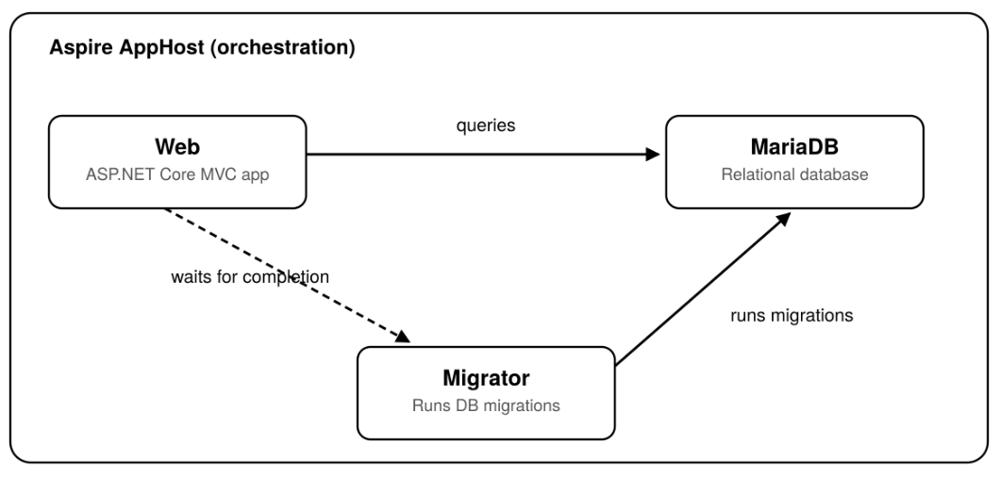
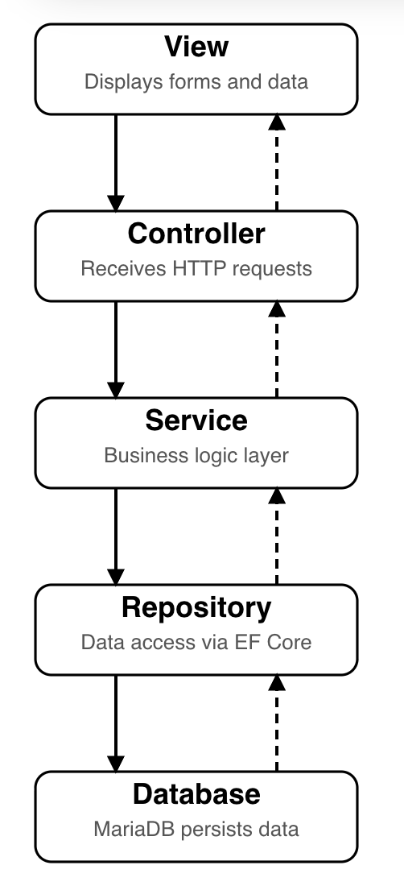

# Architecture

## Components



_Figure 1: Components started and ordered by the Aspire AppHost._

| Component           | Role                                                                                                                                                                     |
| ------------------- | ------------------------------------------------------------------------------------------------------------------------------------------------------------------------ |
| **AppHost**         | Defines the local infrastructure in C#: a MariaDB container, the Migrator and the Web application, including their startup dependencies.                                 |
| **MariaDB**         | Runs the `mariadb:11` container with a persistent data volume. The root password is supplied through the `mariadb-password` secret parameter, and the host port is 3307. |
| **Migrator**        | Console project that applies EF Core migrations and seeds reference data in every environment and development data in Development only, then exits.                      |
| **Web**             | ASP.NET Core MVC application that handles HTTP requests and renders the user interface.                                                                                  |
| **ServiceDefaults** | Provides shared Aspire configuration, including health checks and telemetry.                                                                                             |

### How the components communicate

The AppHost defines the infrastructure and startup dependencies for local development.

```csharp
var builder = DistributedApplication.CreateBuilder(args);

var mariadbPassword = builder.AddParameter(
    "mariadb-password",
    secret: true);

var mariadb = builder.AddMySql(
        "mariadb",
        password: mariadbPassword,
        port: 3307)
    .WithEnvironment("DOTNET_ENVIRONMENT", "Development")
    .WithImage("mariadb", "11")
    .WithDataVolume()
    .AddDatabase("heimevernetdb");

var migrator = builder
    .AddProject<Projects.Heimevernet_Migrator>("migrator")
    .WithEnvironment("DOTNET_ENVIRONMENT", "Development")
    .WithReference(mariadb)
    .WaitFor(mariadb);

builder.AddProject<Projects.Heimevernet>("heimevernet")
    .WithReference(mariadb)
    .WaitFor(mariadb)
    .WaitForCompletion(migrator);

builder.Build().Run();
```

- `WithReference(mariadb)` provides database connection configuration to the dependent projects. They retrieve it using `GetConnectionString("heimevernetdb")`.
- `WaitFor(mariadb)` ensures the database resource is available before the dependent project starts.
- `WaitForCompletion(migrator)` makes the Web application wait for the Migrator to finish successfully.
- `WithDataVolume()` preserves database data between application restarts.

The application does not hardcode its database connection string. The AppHost supplies the connection configuration through Aspire.

## Solution layout

| Folder in the `Heimevernet` project          | Contents                                                                                                            |
| -------------------------------------------- | ------------------------------------------------------------------------------------------------------------------- |
| `Controllers`                                | HTTP entry points. Bind request data, enforce access requirements and return views, redirects or other responses.   |
| `Services` and `Services/Interfaces`         | Application logic, including `NeedService`, `ResourceService`, `AttachmentService`, `AuthService` and `MapService`. |
| `Repositories` and `Repositories/Interfaces` | Data access through `AppDbContext`, with `UnitOfWork` coordinating persistence.                                     |
| `Models`                                     | Domain entities and enums.                                                                                          |
| `ViewModels`, `DTOs`                         | Types used for form input, view rendering and query projections.                                                    |
| `Mappers`                                    | Conversions between entities and view models.                                                                       |
| `Infrastructure/Storage`                     | S3-compatible file storage, configuration options and image-content validation.                                     |
| `Extensions`                                 | Dependency injection registration and claim helpers.                                                                |
| `Data`                                       | `AppDbContext` and EF Core migrations.                                                                              |
| `Views`, `wwwroot`                           | Razor views, CSS and JavaScript modules, including map functionality.                                               |

The solution also contains `Heimevernet.Migrator`, `Heimevernet.AppHost`, `Heimevernet.ServiceDefaults` and `Heimevernet.UnitTests`.

## Request flow

{width=200}
_Figure 2: Requests move down through the layers, and responses return up through them._

| Layer          | Responsibility                                                                                                                                                                |
| -------------- | ----------------------------------------------------------------------------------------------------------------------------------------------------------------------------- |
| **View**       | Renders Razor markup and collects user input.                                                                                                                                 |
| **Controller** | Receives HTTP requests, binds view models, checks authorization, coordinates request-specific validation and calls services. Returns a view, redirect or other HTTP response. |
| **Service**    | Coordinates application logic, including entity creation, mapping, ownership rules and persistence.                                                                           |
| **Repository** | Queries and stages changes through Entity Framework Core. Repositories do not decide when the overall operation should be committed.                                          |
| **Database**   | MariaDB persists application data.                                                                                                                                            |

Repositories stage changes in the EF Core context. Services call `IUnitOfWork.CommitAsync()` when the operation is ready to be persisted. This keeps the commit decision outside individual repository methods and allows multiple staged changes to be saved together.

A single database commit does not, by itself, guarantee atomicity across external services or file storage. Such operations require their own consistency and failure-handling considerations.

#### Example: Retrieve map markers

The map feature demonstrates how the application layers cooperate to retrieve data. The controller handles the HTTP request, the service coordinates marker retrieval, and the repository executes database queries filtered by the visible map area.

**1. Controller: handle the request**

`MapController` validates the query parameters, converts the requested geographical bounds into a `GeoBox`, and delegates retrieval to `MapService`.

```csharp
[HttpGet]
public async Task<IActionResult> Data(
    [FromQuery] MapBoundsRequest bounds,
    CancellationToken cancellationToken)
{
    if (!ModelState.IsValid)
        return BadRequest(ModelState);

    var data = await _mapService.GetMarkersAsync(
        User.GetUserId(),
        User.GetRole(),
        bounds.ToGeoBox(),
        cancellationToken);

    return Json(data);
}
```

The controller handles HTTP-specific concerns and passes the current user's ID, role, and geographical bounds to the service.

**2. Service: coordinate marker retrieval**

`MapService` retrieves needs and resources through their respective application services. Resource visibility depends on the user's role: resource providers can retrieve their own resources regardless of availability, while public actors see available resources.

The service requests one additional marker per kind to detect whether the configured limit of 500 has been exceeded. It then returns at most 500 markers of each kind and indicates whether the results were truncated.

**3. Repository: query the database**

The need repository filters out resolved needs, restricts results to the requested geographical bounds, prioritizes critical needs, and projects the required fields directly into `MapMarkerDto`.

```csharp
return await _context.Needs
    .AsNoTracking()
    .Where(n => n.Status != NeedStatus.Resolved
        && n.Latitude >= box.MinLat
        && n.Latitude <= box.MaxLat
        && n.Longitude >= box.MinLng
        && n.Longitude <= box.MaxLng)
    .OrderByDescending(n => n.Priority == NeedPriority.Critical)
    .ThenByDescending(n => n.CreatedAt)
    .Take(limit)
    .Select(n => new MapMarkerDto(
        n.Id,
        MapMarkerKind.Need,
        n.Title,
        n.Category.Name,
        n.Description,
        n.Region,
        n.Priority.ToString(),
        n.Priority == NeedPriority.Critical,
        n.Status.ToString(),
        n.Deadline,
        n.ContactPoint,
        n.Latitude,
        n.Longitude))
    .ToListAsync(cancellationToken);
```

The query filters and projects data in the database, avoiding the need to load complete entities. `AsNoTracking()` eliminates unnecessary change-tracking overhead for this read-only operation. Ordering critical needs first makes them less likely to be excluded when the result limit is reached.

The resulting marker data passes back through the service to the controller, which returns it as JSON for the browser.

This example illustrates the separation of responsibilities: the controller handles HTTP concerns, the service coordinates application logic and role-dependent behavior, and the repository performs data access.

## Cross-cutting concerns

| Concern                   | Approach                                                                                                                                                                                        |
| ------------------------- | ----------------------------------------------------------------------------------------------------------------------------------------------------------------------------------------------- |
| Authentication            | Cookie authentication. See [Authentication](./features/authentication.md).                                                                                                                      |
| Authorization             | A fallback policy requires authentication by default, while `[Authorize(Roles = "...")]` restricts specific actions. Hiding navigation links is not a substitute for server-side authorization. |
| Validation                | Data annotations and `ModelState` validation, supplemented by server-side checks such as region resolution and file-content validation.                                                         |
| Request forgery           | `[ValidateAntiForgeryToken]` on POST actions.                                                                                                                                                   |
| Configuration and secrets | User Secrets for local development and environment variables in deployment, with options validated at startup where configured.                                                                 |
| Error handling            | Exception handler page and HSTS outside Development.                                                                                                                                            |
| File storage              | S3-compatible storage accessed through `IFileStorage`, with configured storage options and image-content checks.                                                                                |

## Dependency injection

Dependency injection registrations are grouped into extension methods to keep service configuration centralized and reusable.

- `AddPersistence()` registers the unit of work and repositories.
- `AddFileStorage()` registers storage options, the S3 client and `IFileStorage`.
- `AddApplicationServices()` registers application services and mappers.
- `AddAppAuthentication()` registers cookie authentication, the fallback authorization policy and `AuthService` in the Web application.

The Migrator and Web application can share persistence and storage registration where required, while authentication registration is specific to the Web application.

## Known simplifications and limitations

- **Local database account:** Local development uses the MariaDB `root` user. The database is not intended to be exposed directly to external clients.
- **TOTP secret storage:** The TOTP secret is stored unencrypted in the `users` table. Encrypting secrets at rest or using a dedicated secret-management mechanism would reduce the impact of a database compromise.
- **Administration:** There is no admin role or category-management interface. Categories are maintained through migrations or seed code.
- **Region resolution:** Region lookup depends on an external geocoding service. A lookup failure prevents the submitted form from being accepted when coordinates are supplied, so the application depends on that service for region resolution.
- **File storage consistency:** Database transactions do not automatically include S3-compatible storage operations. Uploads and deletions need appropriate failure handling to avoid orphaned files or missing objects.
