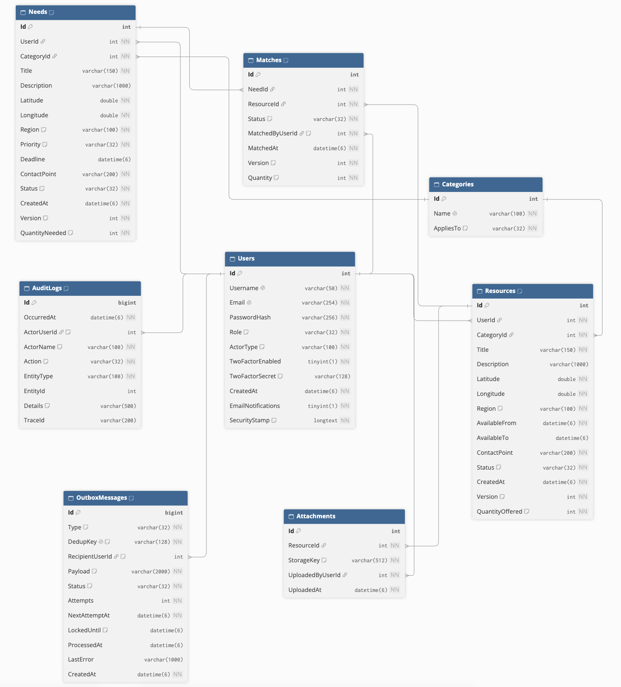

# Database

## Connection

| Setting       | Value                                                          |
| ------------- | -------------------------------------------------------------- |
| Engine        | MariaDB 11 in a Docker container started by the Aspire AppHost |
| Host and port | `localhost:3307` for local development                         |
| User          | `root` for local development                                   |
| Password      | The `Parameters:mariadb-password` user secret                  |
| Database      | `heimevernetdb`                                                |
| Persistence   | A Docker volume, so data survives container restarts           |

The application reads the connection string that Aspire injects under the name `heimevernetdb`. See [Getting started](./getting-started.md) for instructions on resetting the development database volume.

## Entity-relationship diagram



_The diagram shows every table and column with its MariaDB type, whether it allows null, the CHECK rules, the indexes and the delete behaviour of each foreign key. It matches the real database, checked against `information_schema` after running all migrations._

## Tables

All configuration lives in `AppDbContext` (`Heimevernet/Data/AppDbContext.cs`), with one `Configure<Entity>` method per entity. Relationships are configured on the dependent (foreign-key-owning) entity.

> **Naming.** Tables and columns are named exactly as EF Core creates them from the C# classes, in PascalCase: the tables are `Users`, `Categories`, `Needs`, `Resources`, `Attachments`, `Matches`, `AuditLogs` and `OutboxMessages`, and columns are named like `UserId` and `QuantityNeeded`. The same names are used in the ER diagram and in raw SQL.

### `Users`

Stores application accounts. `Role` distinguishes `PublicActor` and `ResourceProvider`, while `ActorType` identifies the type of actor, such as Municipality, Police, Private individual or Company.

`PasswordHash` is generated by the ASP.NET Core `PasswordHasher`. The `TwoFactorEnabled` and `TwoFactorSecret` columns store the TOTP configuration. Users log in using their email address.

`EmailNotifications` (bool, default `true`) is the user's opt-out for [email notifications](./features/notifications.md). It is changed on the account page.

`SecurityStamp` is a random GUID string that is copied into the authentication cookie as a claim. On every request the cookie's stamp is compared with the stored value, and a mismatch signs the user out. Changing the password generates a new stamp, which invalidates all other sessions for that user. Existing rows were backfilled with `UUID()` by the `AddUserSecurityStamp` migration.

`Username` and `Email` each have a unique index.

### `Categories`

Stores lookup values such as Transport, Machinery, Equipment, Power, Communication, Personnel, Premises and Materials. `AppliesTo` (`Need`, `Resource` or `Both`) indicates which entity type can use a category.

The current seed data uses `Both` for all categories, allowing the same category to be used for needs and resources. This supports category-based matching between them.

`Name` has a unique index.

### `Needs`

Stores requests for assistance registered by public actors.

Important columns include `UserId`, `CategoryId`, `Title`, `Description`, `Latitude`, `Longitude`, `Region`, `Priority`, `Deadline`, `ContactPoint`, `Status`, `QuantityNeeded`, `CreatedAt` and `Version`.

`Priority` uses the following values:

- `Low`: A low-priority request.
- `Medium`: A request with moderate priority.
- `Critical`: An urgent request requiring immediate attention.

`Status` tracks the request lifecycle: `New`, `UnderReview`, `Assigned` or `Resolved`.

`QuantityNeeded` specifies how many units of a resource are required. It defaults to `1`, and the check constraint `CK_Needs_QuantityNeeded_Positive` rejects values below `1`.

`Version` is an optimistic concurrency token used to detect conflicting updates. It prevents concurrent operations from silently overwriting changes made by another request.

### `Resources`

Stores resources offered by providers.

Important columns include `UserId`, `CategoryId`, `Title`, `Description`, `Latitude`, `Longitude`, `Region`, `AvailableFrom`, `AvailableTo`, `ContactPoint`, `Status`, `QuantityOffered`, `CreatedAt` and `Version`.

The `Status` field uses:

- `Available`: The resource can be proposed for a need.
- `Busy`: The resource is currently unavailable.

`QuantityOffered` specifies how many units of a resource the provider can offer. It defaults to `1`, and the check constraint `CK_Resources_QuantityOffered_Positive` rejects values below `1`.

`Version` is an optimistic concurrency token used to detect conflicting updates.

### `Attachments`

Stores metadata for resource photos. The image itself is stored in object storage; the database contains the `StorageKey`, `ResourceId`, `UploadedByUserId` and `UploadedAt`.

The public URL is constructed from the storage key when the image is displayed, so the complete URL does not need to be stored in the database.

Attachment rows are deleted automatically when their resource is deleted (cascade). The database cannot remove the objects in storage, so `ResourceService` collects the storage keys before the delete and removes the objects after the transaction has committed.

### `Matches`

Stores explicit pairings between needs and resources.

Each record contains `NeedId`, `ResourceId`, `Status`, `MatchedByUserId`, `Quantity`, `MatchedAt` and `Version`.

The creator is required, so a match records which user initiated the pairing.

`Quantity` specifies how many units of the resource are allocated to the need through that particular match. It defaults to `1`, and the check constraint `CK_Matches_Quantity_Positive` rejects values below `1`.

`Status` tracks the lifecycle of the pairing:

- `UnderReview`: The proposal has been created and is awaiting the Resource Provider's decision.
- `Assigned`: The Resource Provider accepted the proposal and the match quantity has been allocated.
- `Resolved`: The associated need was marked as resolved. All assigned matches for that need become resolved.
- `Rejected`: The Resource Provider rejected the proposal.
- `Cancelled`: The proposal is no longer relevant because another accepted match fully allocated the need or the resource.

`Version` is an optimistic concurrency token used to detect conflicting updates.

A unique index on `(NeedId, ResourceId)` prevents duplicate pairings.

### `AuditLogs`

Stores a historical record of important actions performed by users and the application.

Each record contains:

- `OccurredAt`: When the action occurred.
- `ActorUserId`: The ID of the user responsible for the action. Nullable to support system-generated events or events where the user account is no longer available.
- `ActorName`: The name of the actor, preserved independently of the user account.
- `Action`: The type of action, represented by the `AuditAction` enum.
- `EntityType`: The type of entity affected, such as `Need`, `Resource`, `Match` or `User`.
- `EntityId`: The ID of the affected entity.
- `Details`: Optional additional information about the action.
- `TraceId`: Optional identifier used to correlate the audit entry with application logs and distributed traces.

`Action` covers sign-in and account events (`LoginSucceeded`, `LoginFailed`, `TwoFactorEnabled`, `TwoFactorDisabled`, `PasswordChanged`, `ProfileUpdated`), need events (`NeedCreated`, `NeedEdited`, `NeedDeleted`, `NeedResolved`), resource events (`ResourceCreated`, `ResourceEdited`, `ResourceDeleted`), attachment events (`AttachmentUploaded`, `AttachmentDeleted`) and match events (`MatchProposed`, `MatchAccepted`, `MatchRejected`, `MatchResolved`).

`ActorUserId` references `Users.Id`. Deleting a user sets it to null, so the audit history is kept.

The combination of `EntityType` and `EntityId` identifies the affected entity without requiring a direct foreign key. This allows audit records to reference different entity types using the same table. An index on `(EntityType, EntityId)` supports looking up the history of one entity, and an index on `OccurredAt` supports listing entries by time.

`ActorName` is stored separately from `ActorUserId` so historical records retain the actor's name even if their account is subsequently modified or deleted.

### `OutboxMessages`

Queue of messages for the background worker (see [Email notifications](./features/notifications.md)). Messages are saved in the same database transaction as the change that creates them (transactional outbox).

| Column            | Type                       | Notes                                                    |
| ----------------- | -------------------------- | -------------------------------------------------------- |
| `Id`              | bigint, PK                 |                                                          |
| `Type`            | varchar(32)                | Selects the handler, for example `CriticalNeedEmail`     |
| `DedupKey`        | varchar(128), unique       | Prevents the same message from being queued twice        |
| `RecipientUserId` | int, FK to users, nullable | Null for event messages that fan out                     |
| `Payload`         | varchar(2000)              | JSON with ids and small snapshots, never contact details |
| `Status`          | varchar(32)                | `Pending`, `Processing`, `Done`, `Failed`                |
| `Attempts`        | int                        |                                                          |
| `NextAttemptAt`   | datetime                   | Used for retry delays                                    |
| `LockedUntil`     | datetime, nullable         | Worker lease                                             |
| `ProcessedAt`     | datetime, nullable         | Used by the daily limit                                  |
| `LastError`       | varchar(1000), nullable    |                                                          |
| `CreatedAt`       | datetime                   |                                                          |

Index on `(Status, NextAttemptAt)` for the worker's query. Deleting a user sets `RecipientUserId` to null, so the user's queued messages neither block the delete nor disappear.

```csharp
modelBuilder.Entity<OutboxMessage>(b =>
{
    b.ToTable(t => t.HasCheckConstraint("CK_OutboxMessages_Status_Valid", EnumCheck<OutboxStatus>("Status")));

    b.Property(m => m.Type).HasMaxLength(FieldLimits.EnumText);
    b.Property(m => m.DedupKey).HasMaxLength(FieldLimits.DedupKey);
    b.Property(m => m.Payload).HasMaxLength(FieldLimits.OutboxPayload);
    b.Property(m => m.Status).HasConversion<string>().HasMaxLength(FieldLimits.EnumText);
    b.Property(m => m.LastError).HasMaxLength(FieldLimits.OutboxError);

    b.HasIndex(m => m.DedupKey).IsUnique();                       // the same event is never queued twice
    b.HasIndex(m => new { m.Status, m.NextAttemptAt });           // the worker's "what is due?" query

    // Removing a user must not delete or block their queued messages
    b.HasOne<User>().WithMany().HasForeignKey(m => m.RecipientUserId).OnDelete(DeleteBehavior.SetNull);
});
```

The outbox gives at-least-once delivery. A worker may send an email and stop before marking the row `Done`, and the message is then handled again. Handlers must be safe to run twice.

## Relationships and constraints

- A user can have many needs, resources, uploaded attachments and created matches.
- A user can have many audit log entries.
- A category can be associated with many needs and resources.
- A resource can have many attachments and matches.
- A need can have many matches.
- Each match references one need, one resource and the user who created it.
- Each audit log entry can reference a user through `ActorUserId`, but the relationship is optional.
- Audit entries identify affected entities through `EntityType` and `EntityId` rather than direct foreign keys.
- An outbox message can reference its recipient through `RecipientUserId`. Needs and resources are referenced by id inside the JSON payload, not by foreign key.
- A unique index on `(NeedId, ResourceId)` prevents the same pairing from being stored twice.
- Quantity columns have check constraints that require a value of at least `1`.
- Enum properties are converted to strings in the database for readability, and check constraints limit each enum column to the names defined by its enum.

### Column lengths

String column lengths are not written as numbers in `AppDbContext`. They come from the constants in `FieldLimits` (`Heimevernet/Models/FieldLimits.cs`), which the validation attributes on the view models also use. The form validation and the database column therefore cannot drift apart.

| Constant          | Length | Used by                                        |
| ----------------- | ------ | ---------------------------------------------- |
| `Username`        | 50     | `Users.Username`                               |
| `Email`           | 254    | `Users.Email`                                  |
| `PasswordHash`    | 256    | `Users.PasswordHash`                           |
| `ActorType`       | 100    | `Users.ActorType`                              |
| `TwoFactorSecret` | 128    | `Users.TwoFactorSecret`                        |
| `Title`           | 150    | `Needs.Title`, `Resources.Title`               |
| `Description`     | 1000   | `Needs.Description`, `Resources.Description`   |
| `Region`          | 100    | `Needs.Region`, `Resources.Region`             |
| `ContactPoint`    | 200    | `Needs.ContactPoint`, `Resources.ContactPoint` |
| `CategoryName`    | 100    | `Categories.Name`                              |
| `StorageKey`      | 512    | `Attachments.StorageKey`                       |
| `EnumText`        | 32     | All enum columns and `OutboxMessages.Type`     |
| `AuditActorName`  | 100    | `AuditLogs.ActorName`                          |
| `AuditEntityType` | 100    | `AuditLogs.EntityType`                         |
| `AuditDetails`    | 500    | `AuditLogs.Details`                            |
| `AuditTraceId`    | 200    | `AuditLogs.TraceId`                            |
| `DedupKey`        | 128    | `OutboxMessages.DedupKey`                      |
| `OutboxPayload`   | 2000   | `OutboxMessages.Payload`                       |
| `OutboxError`     | 1000   | `OutboxMessages.LastError`                     |

`FieldLimits.MaxQuantity` (10 000) is the upper bound for quantities. It is enforced by the view models and `MatchService`, not by the database, whose check constraints only enforce the lower bound.

### Enum conversion

`AppDbContext` configures EF Core to store enum values as strings rather than their underlying integer values, in a column limited to `FieldLimits.EnumText` characters.

For example:

```csharp
b.Property(n => n.Priority).HasConversion<string>().HasMaxLength(FieldLimits.EnumText);
b.Property(n => n.Status).HasConversion<string>().HasMaxLength(FieldLimits.EnumText);
```

For example, a need with `Priority = NeedPriority.Critical` is stored as `Critical` instead of its numeric enum value. Because values are stored by name, new enum members can be added anywhere in the enum without changing existing rows, but renaming a member requires a data migration.

The same conversion is configured for `User.Role`, `Category.AppliesTo`, `Resource.Status`, `Match.Status`, `AuditLog.Action` and `OutboxMessage.Status`.

A string column on its own accepts any text, so every enum column also has a check constraint that only allows the enum's names. See [Check constraints](#check-constraints).

### Unique constraints

The model defines unique indexes for usernames, email addresses, category names, need-resource pairings and outbox dedup keys.

```csharp
// ConfigureUser
b.HasIndex(u => u.Username).IsUnique();
b.HasIndex(u => u.Email).IsUnique();

// ConfigureCategory
b.HasIndex(c => c.Name).IsUnique();

// ConfigureMatch
b.HasIndex(m => new { m.NeedId, m.ResourceId }).IsUnique();

// ConfigureOutboxMessage
b.HasIndex(m => m.DedupKey).IsUnique();
```

These constraints provide database-level protection against duplicate values, even if multiple requests attempt to create the same record concurrently.

### Check constraints

The rules below are checked by the application, and the database rejects invalid values as well. This protects the data when rows are written outside the application, for example with raw SQL.

**Quantities** must be at least `1`:

| Constraint                              | Table       | Rule                   |
| --------------------------------------- | ----------- | ---------------------- |
| `CK_Needs_QuantityNeeded_Positive`      | `Needs`     | `QuantityNeeded >= 1`  |
| `CK_Resources_QuantityOffered_Positive` | `Resources` | `QuantityOffered >= 1` |
| `CK_Matches_Quantity_Positive`          | `Matches`   | `Quantity >= 1`        |

**Enum columns** must contain one of the names defined by their enum:

| Constraint                       | Table            | Column      | Enum                |
| -------------------------------- | ---------------- | ----------- | ------------------- |
| `CK_Users_Role_Valid`            | `Users`          | `Role`      | `UserRole`          |
| `CK_Categories_AppliesTo_Valid`  | `Categories`     | `AppliesTo` | `CategoryAppliesTo` |
| `CK_Needs_Priority_Valid`        | `Needs`          | `Priority`  | `NeedPriority`      |
| `CK_Needs_Status_Valid`          | `Needs`          | `Status`    | `NeedStatus`        |
| `CK_Resources_Status_Valid`      | `Resources`      | `Status`    | `ResourceStatus`    |
| `CK_Matches_Status_Valid`        | `Matches`        | `Status`    | `MatchStatus`       |
| `CK_AuditLogs_Action_Valid`      | `AuditLogs`      | `Action`    | `AuditAction`       |
| `CK_OutboxMessages_Status_Valid` | `OutboxMessages` | `Status`    | `OutboxStatus`      |

The enum rules are not written by hand. The `EnumCheck<TEnum>` helper in `AppDbContext` builds the expression from the enum's names, so `EnumCheck<ResourceStatus>("Status")` becomes `Status IN ('Available', 'Busy')`:

```csharp
b.ToTable(t =>
{
    t.HasCheckConstraint("CK_Resources_QuantityOffered_Positive", "QuantityOffered >= 1");
    t.HasCheckConstraint("CK_Resources_Status_Valid", EnumCheck<ResourceStatus>("Status"));
});
```

Adding, renaming or removing an enum member changes the expression. EF Core detects this, so run `dotnet ef migrations add` afterwards. The generated migration drops and re-creates the constraint. Without that migration, the database rejects the new value. Removing or renaming a member also requires existing rows to be updated first, otherwise the new constraint cannot be created.

### Indexes

Besides the unique indexes above and the indexes EF Core creates for foreign keys, the following indexes support the most frequent queries:

| Table            | Columns                                     | Supports                                                                                                  |
| ---------------- | ------------------------------------------- | --------------------------------------------------------------------------------------------------------- |
| `Needs`          | `(Status, Latitude, Longitude)`             | The map. Equality on `Status` first, then a range on `Latitude`; `Longitude` is filtered inside the index |
| `Needs`          | `Region`                                    | The region dropdown (`DISTINCT`) and the region filter                                                    |
| `Resources`      | `(Status, Latitude, Longitude)`             | The map for public actors (`Available` inside a bounding box) and available lists                         |
| `Resources`      | `(CategoryId, Status, Latitude, Longitude)` | Nearby search and candidate matching. Also replaces the separate foreign-key index on `CategoryId`        |
| `Resources`      | `Region`                                    | The region dropdown and the region filter                                                                 |
| `AuditLogs`      | `(EntityType, EntityId)`                    | The history of one entity                                                                                 |
| `AuditLogs`      | `OccurredAt`                                | Listing entries by time                                                                                   |
| `OutboxMessages` | `(Status, NextAttemptAt)`                   | The worker's query for due messages                                                                       |

All are B-tree indexes. Only one column of a composite index can be used as a range, which is why the status (equality) column comes first.

### Optimistic concurrency

`Need`, `Resource` and `Match` implement the `IVersioned` interface and contain a `Version` property, which is configured as a concurrency token with `IsConcurrencyToken()`.

`AppDbContext` overrides `SaveChangesAsync` and increments `Version` on every modified `IVersioned` entity before saving:

```csharp
public override Task<int> SaveChangesAsync(CancellationToken cancellationToken = default)
{
    foreach (var entry in ChangeTracker.Entries<IVersioned>()
                 .Where(e => e.State == EntityState.Modified))
    {
        entry.Entity.Version++;
    }

    return base.SaveChangesAsync(cancellationToken);
}
```

EF Core adds `WHERE Version = <loaded value>` to the `UPDATE`. If another operation has modified the entity in the meantime, no row matches, and EF Core throws a `DbUpdateConcurrencyException` instead of silently overwriting the newer data. Services do not set `Version` themselves.

Only `SaveChangesAsync` increments the version. The synchronous `SaveChanges` and bulk operations such as `ExecuteUpdateAsync` bypass the change tracker and must not be used on versioned entities.

`OutboxMessage` has no version. Workers claim a message with one atomic `UPDATE ... WHERE` that only matches rows that are still due, so two workers can never claim the same row. See [Email notifications](./features/notifications.md#step-2-the-worker-claims-due-rows).

### Delete behaviour

Every relationship has an explicit delete behaviour:

| Relationship                               | On delete of parent | Effect                                                            |
| ------------------------------------------ | ------------------- | ----------------------------------------------------------------- |
| `Needs.UserId` → `Users`                   | Restrict            | A user who has created needs cannot be deleted                    |
| `Needs.CategoryId` → `Categories`          | Restrict            | A category in use by needs cannot be deleted                      |
| `Resources.UserId` → `Users`               | Restrict            | A user who has created resources cannot be deleted                |
| `Resources.CategoryId` → `Categories`      | Restrict            | A category in use by resources cannot be deleted                  |
| `Attachments.ResourceId` → `Resources`     | Cascade             | Deleting a resource deletes its attachment rows                   |
| `Attachments.UploadedByUserId` → `Users`   | Restrict            | A user who has uploaded attachments cannot be deleted             |
| `Matches.NeedId` → `Needs`                 | Restrict            | A need with matches cannot be deleted                             |
| `Matches.ResourceId` → `Resources`         | Restrict            | A resource with matches cannot be deleted                         |
| `Matches.MatchedByUserId` → `Users`        | Restrict            | A user who has created matches cannot be deleted                  |
| `AuditLogs.ActorUserId` → `Users`          | Set null            | The audit entry is kept and the actor reference is cleared        |
| `OutboxMessages.RecipientUserId` → `Users` | Set null            | The queued message is kept and the recipient reference is cleared |

```csharp
// Prevent deleting a need if it has associated matches.
b.HasOne(m => m.Need)
    .WithMany(n => n.Matches)
    .OnDelete(DeleteBehavior.Restrict);

// Preserve audit logs when the associated user is deleted.
b.HasOne(a => a.ActorUser)
    .WithMany(u => u.AuditLogs)
    .HasForeignKey(a => a.ActorUserId)
    .OnDelete(DeleteBehavior.SetNull);
```

Restrict protects the history of matches and the records that reference them. The application applies the same rule first: `OwnedRecordPolicy.CanDeleteNeed` and `CanDeleteResource` refuse to delete a need or resource that has any match, so users get a clear message instead of a database error. The database constraint is the last line of defence if the application check is bypassed.

`AuditLogs.ActorUserId` and `OutboxMessages.RecipientUserId` are nullable, so they can be cleared while the audit entry keeps its `ActorName` and the queued message is still processed.

## Why `Match` is a separate table

Finding available resources near a need is a query and does not require a separate database record. A match represents a decision to pair a particular resource with a particular need.

That decision requires its own status, timestamp, creator and allocated quantity. A status field on `Need` or `Resource` cannot represent the state of each individual pairing when several matches exist.

The `MatchedByUserId` field is required because matches are explicitly created by users rather than generated automatically.

The `Quantity` field allows a resource to be allocated partially across multiple needs, subject to the available quantity and the remaining quantity required by each need.

Remaining quantities are calculated from the quantities of assigned matches rather than stored as separate columns:

- Remaining need quantity = `QuantityNeeded` minus the total quantity of assigned matches for the need.
- Remaining resource quantity = `QuantityOffered` minus the total quantity of assigned matches for the resource.

Only `Assigned` matches count towards allocated quantities. Matches with `UnderReview`, `Rejected` or `Cancelled` status do not reserve quantities. Resolved matches represent previously allocated quantities and should not be counted as available capacity again.

## Status fields

| Table                   | Values                                                         | Meaning                                |
| ----------------------- | -------------------------------------------------------------- | -------------------------------------- |
| `Users.Role`            | `PublicActor`, `ResourceProvider`                              | User account role                      |
| `Needs.Priority`        | `Low`, `Medium`, `Critical`                                    | Importance of the request              |
| `Needs.Status`          | `New`, `UnderReview`, `Assigned`, `Resolved`                   | Overall progress of the request        |
| `Resources.Status`      | `Available`, `Busy`                                            | Current availability of the resource   |
| `Matches.Status`        | `UnderReview`, `Assigned`, `Resolved`, `Rejected`, `Cancelled` | State of the individual pairing        |
| `Categories.AppliesTo`  | `Need`, `Resource`, `Both`                                     | Entity types that can use the category |
| `OutboxMessages.Status` | `Pending`, `Processing`, `Done`, `Failed`                      | Asynchronous message processing state  |

These statuses are separate because they describe different aspects of the application. The database only accepts the values listed here (see [Check constraints](#check-constraints)).

A match does not start as `New`, because a match record is created only after a user initiates a pairing.

A rejected match does not allocate resource quantity. A cancelled match is no longer active and does not reserve quantity. An assigned match represents an accepted allocation. When accepting a match fully allocates the need, the need becomes `Assigned`; when it fully allocates the resource, the resource becomes `Busy`. In both cases the other pending proposals for that need or resource are cancelled. When a need is resolved, its assigned matches become resolved as part of the resolution workflow.

See [Matching](./features/matching.md) for details of how the statuses change together.

## Audit logging and transactional outbox

Audit logging and the transactional outbox serve different purposes.

**Audit logging** records what happened, who performed the action, which entity was affected and when it occurred. It provides a historical record of important application operations.

**The transactional outbox** stores messages that need to be delivered to external services or processed asynchronously.

For example, when a public actor registers a critical need:

1. The need is saved.
2. An audit log entry records `NeedCreated`.
3. A `CriticalNeedRegistered` outbox message is created, which later becomes `CriticalNeedEmail` messages to nearby resource providers.

These database operations are performed within the same transaction. This ensures that the business operation, audit entry and notification request are persisted together.

A background worker processes the outbox independently of the HTTP request. This avoids making the business operation dependent on the immediate availability of an external email service.

## Seeding

| Data             | When                          | Behaviour                                                                |
| ---------------- | ----------------------------- | ------------------------------------------------------------------------ |
| Reference data   | Every environment, at startup | Seeds the category list and updates existing rows to match the seed data |
| Development data | Development only              | Seeds two accounts, two resources with photos and two needs              |

Development records are identified by email address or title so rerunning the seeder does not create duplicate sample records. Sample deadlines are renewed if they have passed.

Seed photos are optional. If an image is missing or storage is unavailable, the Migrator logs a warning and continues.

## Inheritance (generalisation and specialisation)

### `User` as a supertype of `PublicActor` and `ResourceProvider`

The UML model treats `User` as a supertype with two specialised roles. The intended specialisation is total (every user has one of the two roles) and disjoint (a user cannot have both roles simultaneously).

The database uses a single `Users` table with a `Role` discriminator.

| Strategy                          | Description                                                                                                     | Fit for this project                                                                                                                          |
| --------------------------------- | --------------------------------------------------------------------------------------------------------------- | --------------------------------------------------------------------------------------------------------------------------------------------- |
| Single table with a discriminator | One `Users` table with a `Role` column                                                                          | The current approach. Simple and avoids joins; subtype-specific columns would need to be nullable if introduced                               |
| Table per subtype sharing the key | A `Users` table plus `PublicActors` and `ResourceProviders`, each using `UserId` as its primary and foreign key | Suitable if subtypes gain their own required columns, but requires additional joins and coordinated inserts                                   |
| Table per concrete type           | Separate tables containing copies of the shared user columns                                                    | Poor fit because needs, resources, matches and attachments reference users without requiring separate foreign-key relationships for each role |

The single-table approach fits the current model because the roles share the same user fields, while authorization determines which actions each role can perform. If a subtype later requires its own fields, such as a jurisdiction for public actors or an organisation number for providers, table-per-subtype could become more appropriate.

The database enforces that every user has exactly one of these roles. `Role` is a required column, and `CK_Users_Role_Valid` only allows `PublicActor` or `ResourceProvider`.

### `Need` and `Resource` as separate entities

Needs and resources share several fields, including their owner, category, title, description, location, region and contact point. However, they remain separate entities rather than inheriting from a shared posting type.

A need represents a request for assistance, while a resource represents something that can be offered. They have different lifecycle states, different additional fields and distinct roles in the matching relationship. Sharing columns alone is not sufficient reason to introduce a common supertype.

`Category`, `Attachment`, `Match`, `AuditLog` and `OutboxMessage` have no subtypes. `Match` is an association between two entities, not a specialised kind of need or resource. `AuditLog` and `OutboxMessage` are infrastructure entities supporting application-wide functionality.
