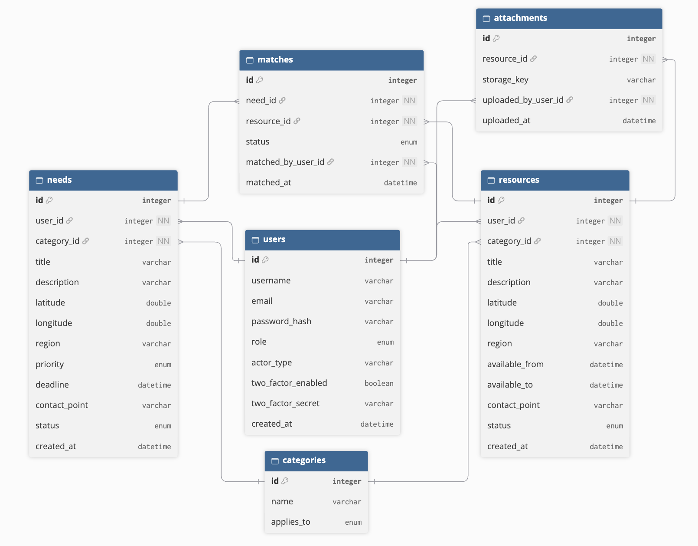

# Database

## Connection

| Setting       | Value                                                          |
| ------------- | -------------------------------------------------------------- |
| Engine        | MariaDB 11 in a Docker container started by the Aspire AppHost |
| Host and port | `localhost:3307` for local development                         |
| User          | `root` for local development                                   |
| Password      | The `Parameters:mariadb-password` user secret                  |
| Database      | `heimevernetdb`                                                |
| Persistence   | A Docker volume, so data survives container restarts           |

The application reads the connection string that Aspire injects under the name `heimevernetdb`. See [Getting started](./getting-started.md) for instructions on resetting the development database volume.

## Entity-relationship diagram



_The diagram shows the key columns. The following sections describe the tables, relationships and constraints._

## Tables

### `users`

Stores application accounts. `role` distinguishes `PublicActor` and `ResourceProvider`, while `actor_type` identifies the type of actor, such as Municipality, Police, Private individual or Company. `password_hash` is generated by the ASP.NET Core `PasswordHasher`. The `two_factor_enabled` and `two_factor_secret` columns store the TOTP configuration. Users log in using their email address.

### `categories`

Stores lookup values such as Transport, Machinery, Equipment, Power, Communication, Personnel, Premises and Materials. `applies_to` (`Need`, `Resource` or `Both`) indicates which entity type can use a category.

The current seed data uses `Both` for all categories, allowing the same category to be used for needs and resources. This supports category-based matching between them.

### `needs`

Stores requests for assistance registered by public actors. Important columns include `user_id`, `category_id`, `title`, `description`, `latitude`, `longitude`, `region`, `priority`, `deadline`, `contact_point`, `status` and `created_at`.

`priority` uses `Low`, `Medium` or `Critical`. `status` tracks the request lifecycle: `New`, `UnderReview`, `Assigned` or `Resolved`.

### `resources`

Stores resources offered by providers. Important columns include `user_id`, `category_id`, `title`, `description`, `latitude`, `longitude`, `region`, `available_from`, `available_to`, `contact_point`, `status` and `created_at`.

The `status` field uses `Available` or `Busy` to indicate resource availability.

### `attachments`

Stores metadata for resource photos. The image itself is stored in object storage; the database contains the `storage_key`, `resource_id`, `uploaded_by_user_id` and `uploaded_at`.

The public URL is constructed from the storage key when the image is displayed, so the complete URL does not need to be stored in the database.

### `matches`

Stores explicit pairings between needs and resources. Each record contains `need_id`, `resource_id`, `status`, `matched_by_user_id` and `matched_at`.

The creator is required, so a match records which user initiated the pairing. A unique index on `(need_id, resource_id)` prevents duplicate pairings.

## Relationships and constraints

- A user can have many needs, resources, uploaded attachments and created matches.
- A category can be associated with many needs and resources.
- A resource can have many attachments and matches.
- A need can have many matches.
- Each match references one need, one resource and the user who created it.
- A unique index on `(need_id, resource_id)` prevents the same pairing from being stored twice.
- Foreign keys for `Match.MatchedByUser` and `Attachment.UploadedByUser` use restricted deletion.
- Enum properties are converted to strings in the database for readability.

### Enum conversion example

`AppDbContext` configures EF Core to store enum values as strings rather than their underlying integer values.

```csharp
modelBuilder.Entity<Need>()
    .Property(n => n.Priority)
    .HasConversion<string>();

modelBuilder.Entity<Need>()
    .Property(n => n.Status)
    .HasConversion<string>();

modelBuilder.Entity<Resource>()
    .Property(r => r.Status)
    .HasConversion<string>();

modelBuilder.Entity<Match>()
    .Property(m => m.Status)
    .HasConversion<string>();
```

For example, a need with `Priority = NeedPriority.Critical` is stored as `Critical` instead of its numeric enum value.

The same conversion is configured for `User.Role` and `Category.AppliesTo`.

### Unique constraints

The model defines unique indexes for usernames, email addresses and need-resource pairings.

```csharp
modelBuilder.Entity<User>()
    .HasIndex(u => u.Username)
    .IsUnique();

modelBuilder.Entity<User>()
    .HasIndex(u => u.Email)
    .IsUnique();

modelBuilder.Entity<Match>()
    .HasIndex(m => new { m.NeedId, m.ResourceId })
    .IsUnique();
```

These constraints provide database-level protection against duplicate values, even if multiple requests attempt to create the same record concurrently.

### Delete behaviour

The creator relationship on `Match` and the uploader relationship on `Attachment` explicitly restrict deletion.

```csharp
modelBuilder.Entity<Match>()
    .HasOne(m => m.MatchedByUser)
    .WithMany(u => u.MatchesCreated)
    .OnDelete(DeleteBehavior.Restrict);

modelBuilder.Entity<Attachment>()
    .HasOne(a => a.UploadedByUser)
    .WithMany(u => u.UploadedAttachments)
    .OnDelete(DeleteBehavior.Restrict);
```

This prevents deleting a user while records still reference that user through these relationships. The delete behaviour of other relationships is determined by their configuration and EF Core conventions.

## Why `Match` is a separate table

Finding available resources near a need is a query and does not require a separate database record. A match represents a decision to pair a particular resource with a particular need.

That decision requires its own status, timestamp and creator. A status field on `Need` or `Resource` cannot represent the state of each individual pairing when several matches exist.

The `matched_by_user_id` field is required because matches are explicitly created by users rather than generated automatically.

## Status fields

| Table              | Values                                            | Meaning                              |
| ------------------ | ------------------------------------------------- | ------------------------------------ |
| `needs.status`     | `New`, `UnderReview`, `Assigned`, `Resolved`      | Overall progress of the request      |
| `resources.status` | `Available`, `Busy`                               | Current availability of the resource |
| `matches.status`   | `UnderReview`, `Assigned`, `Resolved`, `Rejected` | State of the individual pairing      |

These statuses are separate because they describe different aspects of the workflow. A match does not start as `New`, because a match record is created only after a user initiates a pairing.

See [Matching](./features/matching.md) for details of how the statuses change together.

## Seeding

| Data             | When                          | Behaviour                                                                |
| ---------------- | ----------------------------- | ------------------------------------------------------------------------ |
| Reference data   | Every environment, at startup | Seeds the category list and updates existing rows to match the seed data |
| Development data | Development only              | Seeds two accounts, two resources with photos and two needs              |

Development records are identified by email address or title so rerunning the seeder does not create duplicate sample records. Sample deadlines are renewed if they have passed.

Seed photos are optional. If an image is missing or storage is unavailable, the Migrator logs a warning and continues.

## Inheritance (generalisation and specialisation)

### `User` as a supertype of `PublicActor` and `ResourceProvider`

The UML model treats `User` as a supertype with two specialised roles. The intended specialisation is total (every user has one of the two roles) and disjoint (a user cannot have both roles simultaneously).

The database uses a single `users` table with a `role` discriminator.

| Strategy                          | Description                                                                                                        | Fit for this project                                                                                                                          |
| --------------------------------- | ------------------------------------------------------------------------------------------------------------------ | --------------------------------------------------------------------------------------------------------------------------------------------- |
| Single table with a discriminator | One `users` table with a `role` column                                                                             | The current approach. Simple and avoids joins; subtype-specific columns would need to be nullable if introduced                               |
| Table per subtype sharing the key | A `users` table plus `public_actors` and `resource_providers`, each using `user_id` as its primary and foreign key | Suitable if subtypes gain their own required columns, but requires additional joins and coordinated inserts                                   |
| Table per concrete type           | Separate tables containing copies of the shared user columns                                                       | Poor fit because needs, resources, matches and attachments reference users without requiring separate foreign-key relationships for each role |

The single-table approach fits the current model because the roles share the same user fields, while authorization determines which actions each role can perform. If a subtype later requires its own fields, such as a jurisdiction for public actors or an organisation number for providers, table-per-subtype could become more appropriate.

The database model shown does not itself enforce that every user has exactly one of these roles; that invariant must be maintained by application logic or additional database constraints.

### `Need` and `Resource` as separate entities

Needs and resources share several fields, including their owner, category, title, description, location, region and contact point. However, they remain separate entities rather than inheriting from a shared posting type.

A need represents a request for assistance, while a resource represents something that can be offered. They have different lifecycle states, different additional fields and distinct roles in the matching relationship. Sharing columns alone is not sufficient reason to introduce a common supertype.

`Category`, `Attachment` and `Match` have no subtypes. `Match` is an association between two entities, not a specialised kind of need or resource.
