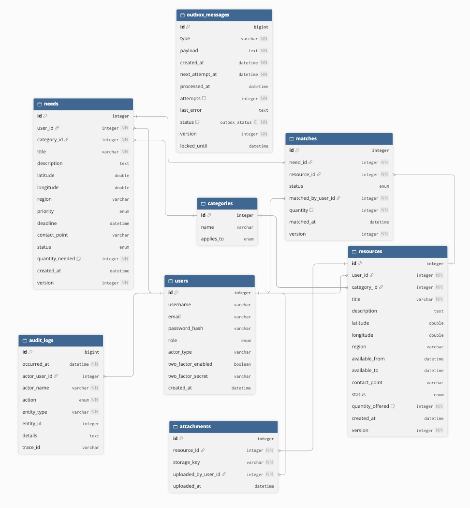

# Database

## Connection

| Setting       | Value                                                          |
| ------------- | -------------------------------------------------------------- |
| Engine        | MariaDB 11 in a Docker container started by the Aspire AppHost |
| Host and port | `localhost:3307` for local development                         |
| User          | `root` for local development                                   |
| Password      | The `Parameters:mariadb-password` user secret                  |
| Database      | `heimevernetdb`                                                |
| Persistence   | A Docker volume, so data survives container restarts           |

The application reads the connection string that Aspire injects under the name `heimevernetdb`. See [Getting started](./getting-started.md) for instructions on resetting the development database volume.

## Entity-relationship diagram



_The diagram shows the key columns. The following sections describe the tables, relationships and constraints._

## Tables

### `users`

Stores application accounts. `role` distinguishes `PublicActor` and `ResourceProvider`, while `actor_type` identifies the type of actor, such as Municipality, Police, Private individual or Company.

`password_hash` is generated by the ASP.NET Core `PasswordHasher`. The `two_factor_enabled` and `two_factor_secret` columns store the TOTP configuration. Users log in using their email address.

`email_notifications` (bool, default `true`) is the user's opt-out for [email notifications](./features/notifications.md). It is changed on the account page.

### `categories`

Stores lookup values such as Transport, Machinery, Equipment, Power, Communication, Personnel, Premises and Materials. `applies_to` (`Need`, `Resource` or `Both`) indicates which entity type can use a category.

The current seed data uses `Both` for all categories, allowing the same category to be used for needs and resources. This supports category-based matching between them.

### `needs`

Stores requests for assistance registered by public actors.

Important columns include `user_id`, `category_id`, `title`, `description`, `latitude`, `longitude`, `region`, `priority`, `deadline`, `contact_point`, `status`, `quantity_needed`, `created_at` and `version`.

`priority` uses the following values:

- `Low`: A low-priority request.
- `Medium`: A request with moderate priority.
- `Critical`: An urgent request requiring immediate attention.

`status` tracks the request lifecycle: `New`, `UnderReview`, `Assigned` or `Resolved`.

`quantity_needed` specifies how many units of a resource are required. It defaults to `1`.

`version` is an optimistic concurrency token used to detect conflicting updates. It prevents concurrent operations from silently overwriting changes made by another request.

### `resources`

Stores resources offered by providers.

Important columns include `user_id`, `category_id`, `title`, `description`, `latitude`, `longitude`, `region`, `available_from`, `available_to`, `contact_point`, `status`, `quantity_offered`, `created_at` and `version`.

The `status` field uses:

- `Available`: The resource can be proposed for a need.
- `Busy`: The resource is currently unavailable.

`quantity_offered` specifies how many units of a resource the provider can offer. It defaults to `1`.

`version` is an optimistic concurrency token used to detect conflicting updates.

### `attachments`

Stores metadata for resource photos. The image itself is stored in object storage; the database contains the `storage_key`, `resource_id`, `uploaded_by_user_id` and `uploaded_at`.

The public URL is constructed from the storage key when the image is displayed, so the complete URL does not need to be stored in the database.

### `matches`

Stores explicit pairings between needs and resources.

Each record contains `need_id`, `resource_id`, `status`, `matched_by_user_id`, `quantity`, `matched_at` and `version`.

The creator is required, so a match records which user initiated the pairing.

`quantity` specifies how many units of the resource are allocated to the need through that particular match. It defaults to `1`.

`status` tracks the lifecycle of the pairing:

- `UnderReview`: The proposal has been created and is awaiting the Resource Provider's decision.
- `Assigned`: The Resource Provider accepted the proposal and the match quantity has been allocated.
- `Resolved`: The associated need was marked as resolved. All assigned matches for that need become resolved.
- `Rejected`: The Resource Provider rejected the proposal.
- `Cancelled`: The proposal is no longer needed because the need was deleted or fully allocated.

`version` is an optimistic concurrency token used to detect conflicting updates.

A unique index on `(need_id, resource_id)` prevents duplicate pairings.

### `audit_logs`

Stores a historical record of important actions performed by users and the application.

Each record contains:

- `occurred_at`: When the action occurred.
- `actor_user_id`: The ID of the user responsible for the action. Nullable to support system-generated events or events where the user account is no longer available.
- `actor_name`: The name of the actor, preserved independently of the user account.
- `action`: The type of action, represented by the `AuditAction` enum.
- `entity_type`: The type of entity affected, such as `Need`, `Resource`, `Match` or `User`.
- `entity_id`: The ID of the affected entity.
- `details`: Optional additional information about the action.
- `trace_id`: Optional identifier used to correlate the audit entry with application logs and distributed traces.

`actor_user_id` references `users.id`.

The combination of `entity_type` and `entity_id` identifies the affected entity without requiring a direct foreign key. This allows audit records to reference different entity types using the same table.

`actor_name` is stored separately from `actor_user_id` so historical records retain the actor's name even if their account is subsequently modified or deleted.

### `outbox_messages`

Queue of messages for the background worker (see [Email notifications](./features/notifications.md)). Messages are saved in the same database transaction as the change that creates them (transactional outbox). EF Core creates the table as `OutboxMessages`.

| Column              | Type                       | Notes                                                    |
| ------------------- | -------------------------- | -------------------------------------------------------- |
| `id`                | bigint, PK                 |                                                          |
| `type`              | varchar(32)                | Selects the handler, for example `CriticalNeedEmail`     |
| `dedup_key`         | varchar(128), unique       | Prevents the same message from being queued twice        |
| `recipient_user_id` | int, FK to users, nullable | Null for event messages that fan out                     |
| `payload`           | varchar(2000)              | JSON with ids and small snapshots, never contact details |
| `status`            | varchar(32)                | `Pending`, `Processing`, `Done`, `Failed`                |
| `attempts`          | int                        |                                                          |
| `next_attempt_at`   | datetime                   | Used for retry delays                                    |
| `locked_until`      | datetime, nullable         | Worker lease                                             |
| `processed_at`      | datetime, nullable         | Used by the daily limit                                  |
| `last_error`        | varchar(1000), nullable    |                                                          |
| `created_at`        | datetime                   |                                                          |

Index on `(status, next_attempt_at)` for the worker's query. Deleting a user sets `recipient_user_id` to null, so the user's queued messages neither block the delete nor disappear.

```csharp
modelBuilder.Entity<OutboxMessage>(b =>
{
    b.Property(m => m.Type).HasMaxLength(FieldLimits.EnumText);
    b.Property(m => m.DedupKey).HasMaxLength(FieldLimits.DedupKey);
    b.Property(m => m.Payload).HasMaxLength(FieldLimits.OutboxPayload);
    b.Property(m => m.Status).HasConversion<string>().HasMaxLength(FieldLimits.EnumText);
    b.Property(m => m.LastError).HasMaxLength(FieldLimits.OutboxError);

    b.HasIndex(m => m.DedupKey).IsUnique();                       // the same event is never queued twice
    b.HasIndex(m => new { m.Status, m.NextAttemptAt });           // the worker's "what is due?" query

    // Removing a user must not delete or block their queued messages
    b.HasOne<User>().WithMany().HasForeignKey(m => m.RecipientUserId).OnDelete(DeleteBehavior.SetNull);
});
```

The outbox gives at-least-once delivery. A worker may send an email and stop before marking the row `Done`, and the message is then handled again. Handlers must be safe to run twice.

## Relationships and constraints

- A user can have many needs, resources, uploaded attachments and created matches.
- A user can have many audit log entries.
- A category can be associated with many needs and resources.
- A resource can have many attachments and matches.
- A need can have many matches.
- Each match references one need, one resource and the user who created it.
- Each audit log entry can reference a user through `actor_user_id`, but the relationship is optional.
- Audit entries identify affected entities through `entity_type` and `entity_id` rather than direct foreign keys.
- An outbox message can reference its recipient through `recipient_user_id`. Needs and resources are referenced by id inside the JSON payload, not by foreign key.
- A unique index on `(need_id, resource_id)` prevents the same pairing from being stored twice.
- Foreign keys for `Match.MatchedByUser` and `Attachment.UploadedByUser` use restricted deletion.
- Enum properties are converted to strings in the database for readability.

### Enum conversion

`AppDbContext` configures EF Core to store enum values as strings rather than their underlying integer values.

For example:

```csharp
modelBuilder.Entity<Need>()
    .Property(n => n.Priority)
    .HasConversion<string>();

modelBuilder.Entity<Need>()
    .Property(n => n.Status)
    .HasConversion<string>();

modelBuilder.Entity<Resource>()
    .Property(r => r.Status)
    .HasConversion<string>();

modelBuilder.Entity<Match>()
    .Property(m => m.Status)
    .HasConversion<string>();
```

For example, a need with `Priority = NeedPriority.Critical` is stored as `Critical` instead of its numeric enum value.

The same conversion is configured for `User.Role`, `Category.AppliesTo`, `AuditLog.Action`, `OutboxMessage.Status` and other enum properties.

### Unique constraints

The model defines unique indexes for usernames, email addresses, need-resource pairings and outbox dedup keys.

```csharp
modelBuilder.Entity<User>()
    .HasIndex(u => u.Username)
    .IsUnique();

modelBuilder.Entity<User>()
    .HasIndex(u => u.Email)
    .IsUnique();

modelBuilder.Entity<Match>()
    .HasIndex(m => new { m.NeedId, m.ResourceId })
    .IsUnique();
```

These constraints provide database-level protection against duplicate values, even if multiple requests attempt to create the same record concurrently.

### Optimistic concurrency

`Need`, `Resource` and `Match` implement the `IVersioned` interface and contain a `Version` property.

The version is used to detect concurrent modifications. When an entity is updated, EF Core checks that its version has not changed since it was loaded. If another operation has modified the entity in the meantime, the update results in a concurrency conflict instead of silently overwriting the newer data.

`OutboxMessage` has no version. Workers claim a message with one atomic `UPDATE ... WHERE` that only matches rows that are still due, so two workers can never claim the same row. See [Email notifications](./features/notifications.md#step-2-the-worker-claims-due-rows).

### Delete behaviour

The creator relationship on `Match` and the uploader relationship on `Attachment` explicitly restrict deletion.

```csharp
modelBuilder.Entity<Match>()
    .HasOne(m => m.MatchedByUser)
    .WithMany(u => u.MatchesCreated)
    .OnDelete(DeleteBehavior.Restrict);

modelBuilder.Entity<Attachment>()
    .HasOne(a => a.UploadedByUser)
    .WithMany(u => u.UploadedAttachments)
    .OnDelete(DeleteBehavior.Restrict);
```

This prevents deleting a user while records still reference that user through these relationships.

The audit log actor relationship should use `DeleteBehavior.SetNull` if audit entries must be preserved when a user is deleted. Its foreign key is nullable, allowing the actor reference to be cleared while retaining the historical `actor_name`.

The delete behaviour of other relationships is determined by their configuration and EF Core conventions.

## Why `Match` is a separate table

Finding available resources near a need is a query and does not require a separate database record. A match represents a decision to pair a particular resource with a particular need.

That decision requires its own status, timestamp, creator and allocated quantity. A status field on `Need` or `Resource` cannot represent the state of each individual pairing when several matches exist.

The `matched_by_user_id` field is required because matches are explicitly created by users rather than generated automatically.

The `quantity` field allows a resource to be allocated partially across multiple needs, subject to the available quantity and the remaining quantity required by each need.

Remaining quantities are calculated from the quantities of assigned matches rather than stored as separate columns:

- Remaining need quantity = `quantity_needed` minus the total quantity of assigned matches for the need.
- Remaining resource quantity = `quantity_offered` minus the total quantity of assigned matches for the resource.

Only `Assigned` matches count towards allocated quantities. Matches with `UnderReview`, `Rejected` or `Cancelled` status do not reserve quantities. Resolved matches represent previously allocated quantities and should not be counted as available capacity again.

## Status fields

| Table                    | Values                                                         | Meaning                                |
| ------------------------ | -------------------------------------------------------------- | -------------------------------------- |
| `users.role`             | `PublicActor`, `ResourceProvider`                              | User account role                      |
| `needs.priority`         | `Low`, `Medium`, `Critical`                                    | Importance of the request              |
| `needs.status`           | `New`, `UnderReview`, `Assigned`, `Resolved`                   | Overall progress of the request        |
| `resources.status`       | `Available`, `Busy`                                            | Current availability of the resource   |
| `matches.status`         | `UnderReview`, `Assigned`, `Resolved`, `Rejected`, `Cancelled` | State of the individual pairing        |
| `categories.applies_to`  | `Need`, `Resource`, `Both`                                     | Entity types that can use the category |
| `outbox_messages.status` | `Pending`, `Processing`, `Done`, `Failed`                      | Asynchronous message processing state  |

These statuses are separate because they describe different aspects of the application.

A match does not start as `New`, because a match record is created only after a user initiates a pairing.

A rejected match does not allocate resource quantity. A cancelled match is no longer active and does not reserve quantity. An assigned match represents an accepted allocation. When its need is resolved, the assigned matches become resolved as part of the resolution workflow.

See [Matching](./features/matching.md) for details of how the statuses change together.

## Audit logging and transactional outbox

Audit logging and the transactional outbox serve different purposes.

**Audit logging** records what happened, who performed the action, which entity was affected and when it occurred. It provides a historical record of important application operations.

**The transactional outbox** stores messages that need to be delivered to external services or processed asynchronously.

For example, when a public actor registers a critical need:

1. The need is saved.
2. An audit log entry records `NeedCreated`.
3. A `CriticalNeedRegistered` outbox message is created, which later becomes emails to nearby resource providers.

These database operations are performed within the same transaction. This ensures that the business operation, audit entry and notification request are persisted together.

A background worker processes the outbox independently of the HTTP request. This avoids making the business operation dependent on the immediate availability of an external email service.

## Seeding

| Data             | When                          | Behaviour                                                                |
| ---------------- | ----------------------------- | ------------------------------------------------------------------------ |
| Reference data   | Every environment, at startup | Seeds the category list and updates existing rows to match the seed data |
| Development data | Development only              | Seeds two accounts, two resources with photos and two needs              |

Development records are identified by email address or title so rerunning the seeder does not create duplicate sample records. Sample deadlines are renewed if they have passed.

Seed photos are optional. If an image is missing or storage is unavailable, the Migrator logs a warning and continues.

## Inheritance (generalisation and specialisation)

### `User` as a supertype of `PublicActor` and `ResourceProvider`

The UML model treats `User` as a supertype with two specialised roles. The intended specialisation is total (every user has one of the two roles) and disjoint (a user cannot have both roles simultaneously).

The database uses a single `users` table with a `role` discriminator.

| Strategy                          | Description                                                                                                        | Fit for this project                                                                                                                          |
| --------------------------------- | ------------------------------------------------------------------------------------------------------------------ | --------------------------------------------------------------------------------------------------------------------------------------------- |
| Single table with a discriminator | One `users` table with a `role` column                                                                             | The current approach. Simple and avoids joins; subtype-specific columns would need to be nullable if introduced                               |
| Table per subtype sharing the key | A `users` table plus `public_actors` and `resource_providers`, each using `user_id` as its primary and foreign key | Suitable if subtypes gain their own required columns, but requires additional joins and coordinated inserts                                   |
| Table per concrete type           | Separate tables containing copies of the shared user columns                                                       | Poor fit because needs, resources, matches and attachments reference users without requiring separate foreign-key relationships for each role |

The single-table approach fits the current model because the roles share the same user fields, while authorization determines which actions each role can perform. If a subtype later requires its own fields, such as a jurisdiction for public actors or an organisation number for providers, table-per-subtype could become more appropriate.

The database model shown does not itself enforce that every user has exactly one of these roles; that invariant must be maintained by application logic or additional database constraints.

### `Need` and `Resource` as separate entities

Needs and resources share several fields, including their owner, category, title, description, location, region and contact point. However, they remain separate entities rather than inheriting from a shared posting type.

A need represents a request for assistance, while a resource represents something that can be offered. They have different lifecycle states, different additional fields and distinct roles in the matching relationship. Sharing columns alone is not sufficient reason to introduce a common supertype.

`Category`, `Attachment`, `Match`, `AuditLog` and `OutboxMessage` have no subtypes. `Match` is an association between two entities, not a specialised kind of need or resource. `AuditLog` and `OutboxMessage` are infrastructure entities supporting application-wide functionality.
