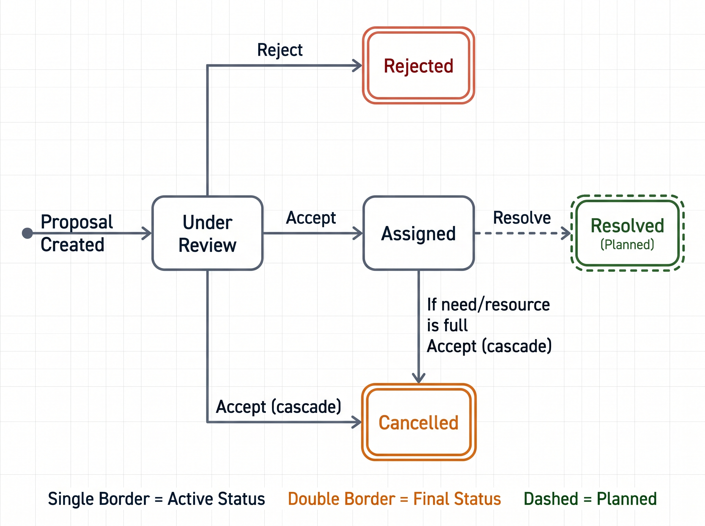
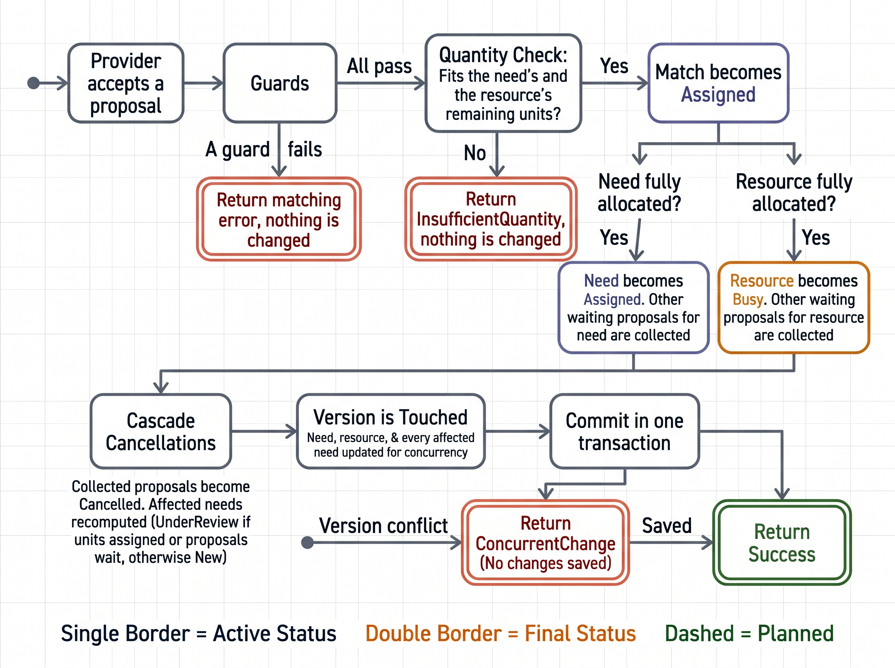

# Matching

Matching connects a need to resources that can fulfil it. It has two parts:

- **Candidates** are resources that could fulfil a need. They are computed on demand and never stored.
- **Matches** are stored rows. A match is created only when the owner of a need proposes a resource, and it is answered by the owner of that resource.

A need can ask for several units (for example 4 drones), and a resource can offer several units. Several matches can therefore contribute to one need, and one resource can serve several needs over time.

## Concepts

| Term                   | Meaning                                                                                                   |
| ---------------------- | --------------------------------------------------------------------------------------------------------- |
| **Need**               | A request registered by a public actor, for `QuantityNeeded` units                                        |
| **Resource**           | Something a provider offers, with `QuantityOffered` units                                                 |
| **Candidate**          | A resource that fits a need. Computed, never stored                                                       |
| **Match**              | A proposal that one resource supplies `Quantity` units to one need. It has its own status and creator     |
| **Allocated quantity** | The units fixed by accepted matches. Remaining units are always derived from the matches and never stored |

## Who does what

| Step | Role              | What happens                                                                                                                    |
| ---- | ----------------- | ------------------------------------------------------------------------------------------------------------------------------- |
| 1    | Public actor      | Registers a need with a quantity                                                                                                |
| 2    | Resource provider | Registers a resource with a quantity                                                                                            |
| 3    | Public actor      | Opens the need, sees the candidate resources and proposes one for a chosen quantity. Only the owner of the need sees candidates |
| 4    | Resource provider | Sees the proposal in **My matches** and accepts or rejects it                                                                   |
| 5    | Public actor      | Marks the need as resolved when the work is done (**planned**, see [Resolve](#resolve-planned))                                 |

A proposal reserves nothing. Units are committed only when the resource owner accepts, so a public actor can send several proposals for the same need, and each resource owner decides for their own resource.

## Data model

```csharp
public class Match : IVersioned
{
    public int Id { get; set; }

    public int NeedId { get; set; }
    public Need Need { get; set; } = null!;

    public int ResourceId { get; set; }
    public Resource Resource { get; set; } = null!;

    public MatchStatus Status { get; set; } = MatchStatus.UnderReview;

    public int MatchedByUserId { get; set; }          // the need owner who proposed it, never null
    public User MatchedByUser { get; set; } = null!;

    public int Quantity { get; set; } = 1;            // units this match covers

    public DateTime MatchedAt { get; set; } = DateTime.UtcNow;

    public int Version { get; set; }                  // concurrency token
}
```

A unique index on `(NeedId, ResourceId)` allows a resource to be proposed for a need only once. `Need` and `Resource` also carry a `Version`, and the status columns are stored as text. See [Database](../database.md) for the tables.

## Match status



_Figure 1: The lifecycle of a match. Double borders mark final states, and the dashed part is planned._

| Status        | Meaning                                                                                             | Set by           | Final |
| ------------- | --------------------------------------------------------------------------------------------------- | ---------------- | ----- |
| `UnderReview` | Proposed, waiting for the resource owner                                                            | Propose          | No    |
| `Assigned`    | Accepted, and the quantity is allocated                                                             | Accept           | No    |
| `Rejected`    | The resource owner said no                                                                          | Reject           | Yes   |
| `Cancelled`   | The proposal became pointless because the need is fully allocated or the resource has no units left | Accept (cascade) | Yes   |
| `Resolved`    | The work is done and the units are permanently consumed                                             | Planned          | Yes   |

A match starts at `UnderReview`, because a match row only exists once someone has proposed it. The need and resource statuses are kept in step with the matches in the same transaction, so they cannot disagree.

| Event                                       | Match                                                                 | Need                                                                                     | Resource                            |
| ------------------------------------------- | --------------------------------------------------------------------- | ---------------------------------------------------------------------------------------- | ----------------------------------- |
| Propose                                     | Created as `UnderReview`                                              | `New` becomes `UnderReview`                                                              | Unchanged                           |
| Accept, units left on both sides            | `Assigned`                                                            | Unchanged                                                                                | Unchanged                           |
| Accept, the need is now fully allocated     | `Assigned`. The need's other waiting proposals become `Cancelled`     | `Assigned`                                                                               | `Busy` if it is now fully committed |
| Accept, the resource is now fully committed | `Assigned`. The resource's other waiting proposals become `Cancelled` | The needs behind the cancelled proposals are recomputed                                  | `Busy`                              |
| Reject                                      | `Rejected`                                                            | Recomputed: `UnderReview` if units are assigned or other proposals wait, otherwise `New` | Unchanged                           |

## Quantities

```
remainingNeed     = max(0, need.QuantityNeeded      - allocatedNeedQuantity)
remainingResource = max(0, resource.QuantityOffered - allocatedResourceQuantity)
maxAllowed        = min(remainingNeed, remainingResource)
```

The allocated quantity is the sum of `Quantity` over the matches that are `Assigned` or `Resolved`. It is computed by the database with `GetAllocatedQuantityForNeedAsync` and `GetAllocatedQuantityForResourceAsync`, and not kept in a counter column. A counter would be a second copy of a fact that the matches already hold, and every code path that touches matches would have to keep it in step. Only the statuses are stored, because the map and the candidate query filter on them.

Both repository queries (`GetAllocatedQuantityForNeedAsync` and `GetAllocatedQuantityForResourceAsync`) count both `Assigned` and `Resolved` matches. Because resources represent consumed allocations, resolving a need does not release units back into the pool.

## Candidates

`GetCandidateResourcesAsync(needId)` returns the resources that could be proposed for a need:

- The need must exist and be `New` or `UnderReview`. Otherwise the list is empty.
- The repository filters by the need's category, availability, expiry and deadline. The need id is passed in so that pairs that already have a match are not offered again.
- Each candidate gets a distance from the need, and the list is sorted by distance and then by id. There is no distance limit and no paging. The person is choosing between acceptable options, and the list is short.
- Only the owner of the need sees candidates (`CanProposeAsync`).

## Propose

`ProposeAsync(needId, resourceId, quantity, userId)` checks in this order and stops at the first failure.

| Check                                                            | Result when it fails                          |
| ---------------------------------------------------------------- | --------------------------------------------- |
| Quantity is between 1 and the maximum                            | `InvalidQuantity`                             |
| The need exists                                                  | `NeedNotFound`                                |
| The caller owns the need                                         | `UserIsNotNeedOwner`                          |
| The need is `New` or `UnderReview`                               | `NeedNotOpen`                                 |
| The resource exists                                              | `ResourceNotFound`                            |
| The resource is `Available`                                      | `ResourceNotAvailable`                        |
| The pair has no match yet, including rejected and cancelled ones | `MatchAlreadyExists`                          |
| `MatchRules.IsSuitable(need, resource, now)`                     | `ResourceNotSuitable`                         |
| Quantity does not exceed what both sides have left               | `ExceedsRemaining`, together with the maximum |

When every check passes, the match is created, a `New` need becomes `UnderReview`, and the need is marked for a version check:

```csharp
await _matchRepository.AddAsync(match, cancellationToken);

if (need.Status == NeedStatus.New)
{
    need.Status = NeedStatus.UnderReview;
}

// Two people cannot propose for the same need at the same instant
_needRepository.MarkForConcurrencyCheck(need);
```

The resource is not touched, because a proposal reserves nothing. A duplicate pair that slips past the check is stopped by the unique index and returned as `MatchAlreadyExists`. A version conflict is returned as `ConcurrentChange`.

## Accept



_Figure 2: What happens when a resource owner accepts a proposal. Dashed boxes are early returns that change nothing._

`AcceptAsync(matchId, userId)` runs these guards first.

| Check                                         | Result when it fails     |
| --------------------------------------------- | ------------------------ |
| The match exists                              | `MatchNotFound`          |
| The caller owns the resource                  | `UserIsNotResourceOwner` |
| The match is `UnderReview`                    | `MatchNotUnderReview`    |
| The need is `New` or `UnderReview`            | `NeedNotOpen`            |
| The resource is `Available`                   | `ResourceNotAvailable`   |
| The pair is still suitable                    | `ResourceNotSuitable`    |
| The match quantity fits both remaining counts | `InsufficientQuantity`   |

The quantity is checked again at this point, because it is the binding check. The one made when proposing only gives early feedback, since proposals reserve nothing. Then the cascade runs:

```csharp
match.Status = MatchStatus.Assigned;

if (allocatedNeedQuantity + match.Quantity >= match.Need.QuantityNeeded)
{
    match.Need.Status = NeedStatus.Assigned;
    // the need's other waiting proposals are collected
}

if (allocatedResourceQuantity + match.Quantity >= match.Resource.QuantityOffered)
{
    match.Resource.Status = ResourceStatus.Busy;
    // the resource's other waiting proposals are collected
}

foreach (var pending in matchesToCancel.Values)
{
    pending.Status = MatchStatus.Cancelled;
}
```

Proposals are cancelled only when nothing is left to give. A need for four units keeps its other proposals alive while units are still missing, and a resource keeps its proposals while it still has free units. For each need that lost a proposal, the status is recomputed: `UnderReview` if some units are assigned or other proposals still wait, otherwise `New`. The need that was just accepted for is skipped when it is already fully allocated.

## Reject

`RejectAsync(matchId, userId)` uses the same first three guards as accept (`MatchNotFound`, `UserIsNotResourceOwner`, `MatchNotUnderReview`). It sets the match to `Rejected` and recomputes the need from two numbers: the units already allocated, and the proposals still waiting.

```csharp
match.Status = MatchStatus.Rejected;

var fulfilled = await _matchRepository.GetAllocatedQuantityForNeedAsync(match.Need.Id, cancellationToken);
var waiting = await _matchRepository.CountPendingForNeedAsync(match.Need.Id, match.Id, cancellationToken);

match.Need.Status = fulfilled > 0 || waiting > 0
    ? NeedStatus.UnderReview
    : NeedStatus.New;
```

A need goes back to `New` only when this was its last open proposal and nothing is assigned yet. The resource is unchanged, because it was never reserved.

## Resolve

When the work is done, the owner of the need marks the **need** as resolved:

1. Every `Assigned` match of the need becomes `Resolved`.
2. Every proposal still waiting for the need becomes `Cancelled`, so no stale proposal is left behind.
3. The need becomes `Resolved`. The final status is never changed again, and a resolved need cannot receive proposals.
4. Resolved matches remain counted as allocated quantity against the resource. Nothing is freed or released back into the available pool.
5. The change runs in one transaction with the same version checks as accept.

## Concurrency

Two people can act on the same rows at the same time: two providers accepting proposals for the same need, one provider accepting twice, or a proposal arriving while another is rejected. We use optimistic concurrency, with a `Version` column on needs, resources and matches.

```csharp
_needRepository.MarkForConcurrencyCheck(match.Need);
_resourceRepository.MarkForConcurrencyCheck(match.Resource);

try
{
    await _unitOfWork.CommitAsync(cancellationToken);
}
catch (ConcurrencyConflictException)
{
    return MatchDecisionResult.ConcurrentChange;
}
```

`MarkForConcurrencyCheck` forces the `Version` of a parent row into the save, even when none of its statuses changed. Saving increments the version, and the database applies the change only when the version still has the value that was read:

```sql
UPDATE Needs SET Status = 'Assigned', Version = 4 WHERE Id = 7 AND Version = 3;
```

If someone else saved first, the update changes no rows. The unit of work turns that into `ConcurrencyConflictException`, and the service returns `ConcurrentChange` ("someone changed this at the same time, reload and try again"). The transaction rolls back, so a half-finished cascade is never saved.

| Operation | Rows whose version is checked                                      | What it protects against                                                                   |
| --------- | ------------------------------------------------------------------ | ------------------------------------------------------------------------------------------ |
| Propose   | The need                                                           | Two proposals for one need at once, and a proposal racing an accept or reject on that need |
| Accept    | The need, the resource and every need whose proposal was cancelled | Two accepts overbooking the same need or resource, and an accept racing a proposal         |
| Reject    | The need                                                           | A reject racing a proposal or an accept on the same need                                   |

The resource is not checked when proposing or rejecting, because neither reserves anything. A proposal can therefore land on a resource that is just becoming full. That is harmless: the owner's accept is rejected with `InsufficientQuantity` or `ResourceNotAvailable`.

## Worked examples

### Several resources for one need

A need asks for **4 drones**. Provider A offers 2 (R1), B offers 1 (R2), C offers 5 (R3) and D offers 1 (R4).

| Step | Action                                                                    | Matches                                                         | Need                   | Resources                                                |
| ---- | ------------------------------------------------------------------------- | --------------------------------------------------------------- | ---------------------- | -------------------------------------------------------- |
| 0    | The need is registered                                                    | none                                                            | `New`                  | all `Available`                                          |
| 1    | The need owner proposes M1 (R1, 2), M2 (R2, 1), M3 (R3, 1) and M4 (R4, 1) | all `UnderReview`                                               | `UnderReview`          | all `Available`, because proposals reserve nothing       |
| 2    | A accepts M1                                                              | M1 `Assigned`                                                   | `UnderReview` (2 of 4) | R1 `Busy` (2 of 2)                                       |
| 3    | B accepts M2                                                              | M2 `Assigned`                                                   | `UnderReview` (3 of 4) | R2 `Busy`                                                |
| 4    | C accepts M3                                                              | M3 `Assigned`. M4 becomes `Cancelled`, because the need is full | `Assigned` (4 of 4)    | R3 stays `Available` (1 of 5 used). R4 stays `Available` |

### One resource wanted by two needs

Provider A offers 2 drones (R1). Need N1 asks for 2 and need N2 asks for 2. Both owners propose R1, giving M1 for N1 and M5 for N2, both `UnderReview`.

1. A accepts M1. R1 is now fully committed (2 of 2) and becomes `Busy`. N1 is fully allocated and becomes `Assigned`.
2. M5 can no longer succeed, so it becomes `Cancelled`.
3. N2 has no allocated units and no other waiting proposals, so it returns to `New`.

## Known limitations

- **A rejected or cancelled pair cannot be proposed again.** The existence check and the unique index block it, including when a proposal was cancelled only because the need or the resource was full. If units free up later, the pair stays blocked. Reusing the old row by setting it back to `UnderReview` would lift this.
