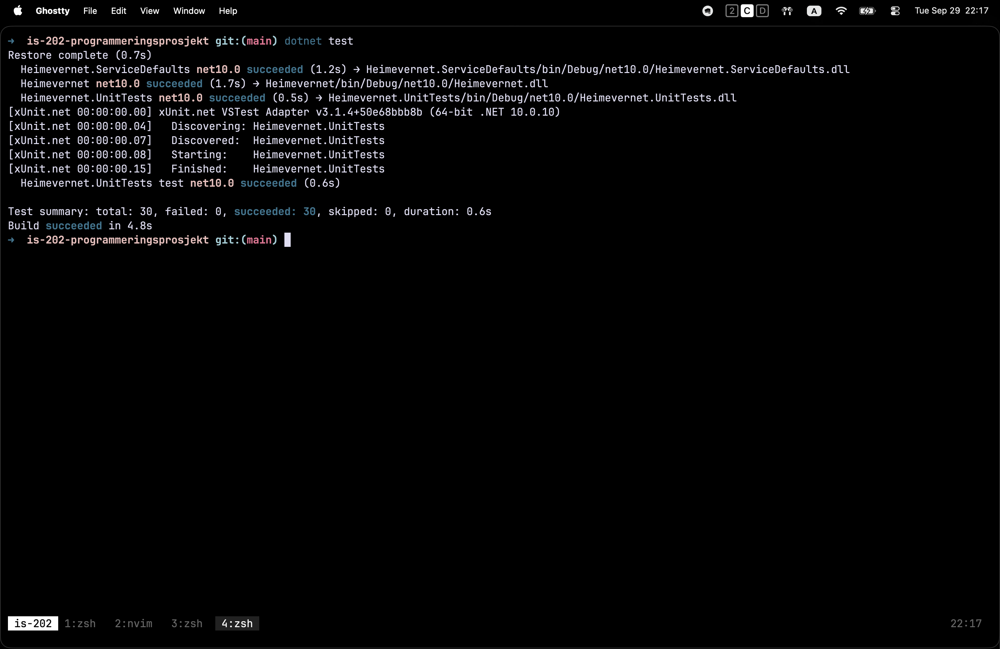

# Testing

The project uses automated unit tests to verify business logic. Integration tests have not been implemented yet, and the existing unit tests do not cover all application components or behaviours. In particular, controllers, database interactions, authentication, file storage and the browser interface are not fully covered by automated tests.

## Automated tests

### What they cover

| Test class                               | Checks                                                                                                                                                                                                        |
| ---------------------------------------- | ------------------------------------------------------------------------------------------------------------------------------------------------------------------------------------------------------------- |
| `NeedServiceTests`                       | Create saves the entity and commits. A repository failure does not commit. Values are trimmed before saving. Get all, summaries and get by ID return mapped view models, including empty and not-found cases. |
| `ResourceServiceTests`                   | Corresponding service behaviours for resources.                                                                                                                                                               |
| `NeedMapperTests`, `ResourceMapperTests` | Entity-to-view-model and reverse mapping, trimming, nullable fields, collections and empty collections.                                                                                                       |

The tests use xUnit and Moq. Repositories and the unit of work are mocked, while the real mappers are used in service tests. This allows mapping changes to be tested directly and through the services that use them.

### Current limitations

Integration tests have not been implemented. The existing unit tests do not cover all business logic or application components.

Areas without sufficient automated test coverage include:

- Controllers and HTTP request handling.
- Database repositories and actual database interactions.
- Authentication and two-factor authentication.
- Attachment uploads, validation and storage operations.
- Map services and client-side map behaviour.
- Razor views, forms and responsive layouts.
- Interactions between application components and external services.

Unit tests verify isolated behaviour, often using mocks. They do not establish that the complete application works correctly end to end. Integration tests are needed to verify interactions between components, including database persistence and storage operations.

## Run tests

Run the test suite from the solution directory:

```bash
dotnet test Heimevernet.slnx
```

## Continuous integration

GitHub Actions runs the CI workflow on every push and pull request targeting `main`. The workflow runs on `ubuntu-latest` and uses .NET 10.

The pipeline:

1. Checks out the repository.
2. Installs the .NET 10 SDK.
3. Restores dependencies for `Heimevernet.slnx`.
4. Builds the solution in Release configuration.
5. Runs `Heimevernet.UnitTests` without rebuilding.
6. Publishes the TRX test results as a GitHub Actions check, even if an earlier step fails.

The workflow is defined in `.github/workflows/ci.yml`:

```yaml
name: CI

on:
  push:
    branches:
      - main
  pull_request:
    branches:
      - main

jobs:
  ci:
    runs-on: ubuntu-latest

    steps:
      - name: Checkout
        uses: actions/checkout@v4

      - name: Setup .NET
        uses: actions/setup-dotnet@v4
        with:
          dotnet-version: "10.0.x"

      - name: Restore
        run: dotnet restore Heimevernet.slnx

      - name: Build
        run: dotnet build Heimevernet.slnx --no-restore --configuration Release

      - name: Test
        run: >
          dotnet test Heimevernet.UnitTests/Heimevernet.UnitTests.csproj
          --no-build
          --configuration Release
          --logger "trx;LogFileName=test-results.trx"

      - name: Publish test results
        uses: dorny/test-reporter@v1
        if: always()
        with:
          name: Test Results
          path: "**/test-results.trx"
          reporter: dotnet-trx
```

The test step generates a TRX report, and `dorny/test-reporter` publishes the results. The `if: always()` condition allows the reporting step to run even when a previous step fails, provided a report exists.

## Latest test result


