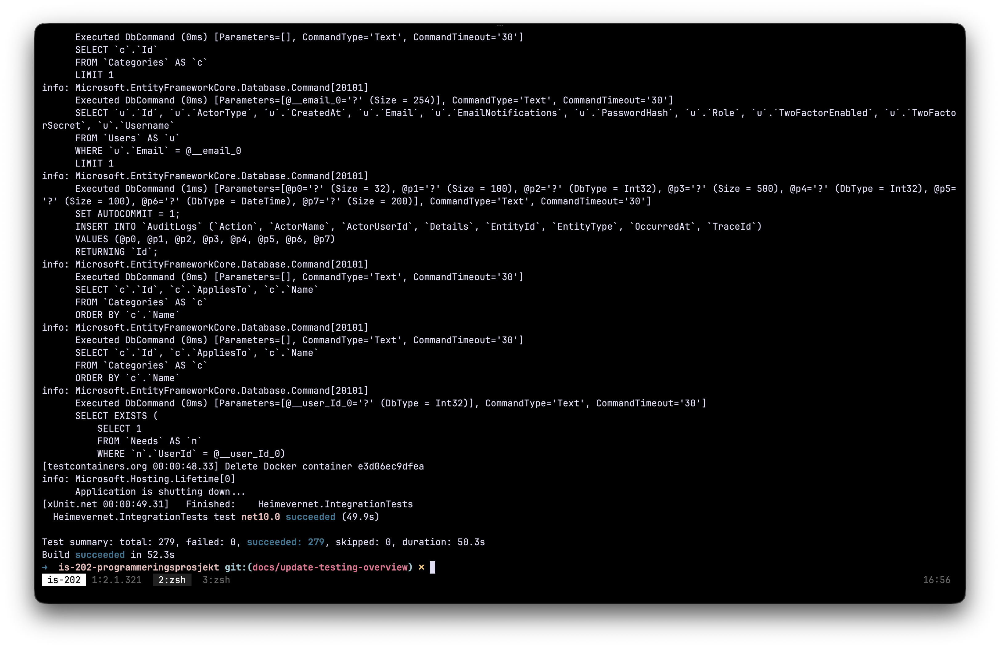

# Testing

The project has two automated test projects with 279 tests in total, and all of them pass.

| Project                        | Tests | What it tests                                                    | Needs                                |
| ------------------------------ | ----- | ---------------------------------------------------------------- | ------------------------------------ |
| `Heimevernet.UnitTests`        | 102   | Services, mappers and the exporter, in isolation                 | Nothing                              |
| `Heimevernet.IntegrationTests` | 177   | Full HTTP requests through controllers, services and a real database | Docker running and the storage secrets |

## Unit tests

Unit tests check business rules in isolation. They use **xUnit** and **Moq**: repositories, the unit of work and other services are mocked, while the real mappers are used inside service tests. A mapping change is therefore tested both directly and through the services that use it.

| Test class                               | Checks                                                                                                                                                                                                                                     |
| ---------------------------------------- | ------------------------------------------------------------------------------------------------------------------------------------------------------------------------------------------------------------------------------------------ |
| `NeedServiceTests`, `ResourceServiceTests` | Create saves, writes an audit entry and commits, and a repository or audit failure does not commit. Creating a critical need or any resource queues a notification event in the outbox, while low and medium needs queue nothing. Get returns mapped view models, including empty and not-found cases. Update and delete check the owner, reject protected-field changes while a match is pending, return a conflict on a concurrency conflict, and never change the owner, status or creation time. Resolving a need resolves its assigned matches, leaves the others alone and is refused unless the need is assigned. |
| `AuthServiceTests`                       | Registration hashes the password, trims input and rejects an existing email. Login handles an unknown email, a wrong password, and accounts with and without two-factor. Two-factor setup returns a QR code and only enables 2FA after a valid code. Sign-in issues the expected claims. |
| `ResourceExporterTests`                  | CSV starts with a UTF-8 BOM, follows the header order, formats dates, quotes special characters and neutralises formula prefixes (`=`, `+`, `-`, `@`, tab and carriage return) to prevent CSV injection. JSON exports only the agreed fields, uses ISO dates and keeps Norwegian letters readable. |
| `YourDataServiceTests`                  | The overview returns `null` for an unknown user, maps the account fields and only reads the user's own activity, newest first. Activity on a listing is labelled with its region, or its id if the listing is gone. The export includes the account, listings and activity. |
| `NeedMapperTests`, `ResourceMapperTests` | Mapping from entity to view model and back, trimming, nullable fields and empty collections.                                                                                                                                                       |

## Integration tests

Integration tests send real HTTP requests to the application and check the response and the resulting database state. They show that controllers, authorisation, validation, services, EF Core and the database work together. The outbox and recipient tests call the services and repositories directly instead, because they test database behaviour such as concurrent claims and SQL queries that a mock could not reproduce.

### How they work

- **`HeimevernetWebApplicationFactory`** starts the real application in memory with `WebApplicationFactory` in the `Testing` environment.
- **Testcontainers** starts a fresh **MariaDB 11** container, the same engine as in production. The factory applies the EF Core migrations and seeds the reference data (categories) before the first test.
- Each test class gets its own factory and database through `IClassFixture`. Inside a class, every test creates its own users with unique emails through **`TestDataFactory`**, so tests do not depend on each other.
- **`AuthenticatedClientHelper`** logs a test user in and returns a client with the login cookie.
- **`AntiforgeryHelper`** reads the anti-forgery token from a form and posts it back, just like a browser. Form posts therefore go through the same CSRF protection as in production.
- File storage uses the separate test bucket `test_bucket_is202`, so tests never touch development or production files.
- **`NotificationsWebApplicationFactory`** extends the normal factory for the notification tests. It switches email on, swaps the real sender for **`FakeEmailSender`**, which records emails instead of sending them, and removes the background `OutboxWorker`. Tests call `DrainOutboxAsync` to process the outbox the way the worker does, so they decide when it runs instead of racing a timer.
- **`NotificationTestData`** places users, needs and resources in a fresh area for each test. Areas are over 400 km apart, far outside the 50 km search radius, so rows from other tests never become recipients.

### What they cover

| Area          | Test classes                                                                                                     | Checks                                                                                                                                                                                                                                                                                           |
| ------------- | ---------------------------------------------------------------------------------------------------------------- | ------------------------------------------------------------------------------------------------------------------------------------------------------------------------------------------------------------------------------------------------------------------------------------------------- |
| Account       | `LoginTests`, `LogoutTests`, `RegistrationTests`, `TwoFactorAuthenticationTests`, `TwoFactorSetupTests`, `AccountPageTests` | Valid and invalid login with a generic error message, logout only through POST, registration without duplicates, the full two-factor login and setup flow, and protected pages redirecting anonymous users to login.                                                                              |
| Your data     | `YourDataPageTests`                                                                                              | The page and the export redirect anonymous users to login. Both roles see their own account details, and the activity list only shows the user's own entries. The JSON export contains the account, needs, resources and activity, but never the password hash or the two-factor secret.          |
| Privacy       | `PrivacyPageTests`                                                                                               | The privacy policy opens for anonymous visitors without a redirect to login.                                                                                                                                                                                                                       |
| Needs         | `CreateNeedTests`, `EditNeedTests`, `DeleteNeedTests`, `ResolveNeedTests`                                        | Creating with validation (title, category, quantity, latitude). Only the owner may edit, delete or resolve. Resource providers and anonymous users are refused. A need with a pending or assigned match cannot be deleted. Only an assigned need can be resolved: its assigned matches become resolved, rejected and cancelled matches are left alone, and both changes are audited. New, under-review and already resolved needs return `409`. |
| Resources     | `CreateResourceTests`, `EditResourceTests`, `DeleteResourceTests`                                                | Creating with validation, including `AvailableTo` before `AvailableFrom`. Only the owner may edit or delete, and a resource with a match cannot be deleted.                                                                                                                                         |
| Export        | `ExportResourceTests`                                                                                            | CSV and JSON export of available resources, with and without a region filter. Only the allowed role can export, and the print-by-region page keeps the selected region in its export links.                                                                                                      |
| Matching      | `MatchProposalTests`, `MatchAcceptanceTests`, `MatchRejectionTests`                                              | Proposing (no duplicates, valid quantity, only the need owner, not to busy resources). Accepting and rejecting (only the resource owner, only proposals under review, quantity limits on both sides). When a need or resource becomes fully allocated, other pending proposals are cancelled. After a rejection, the need's status falls back correctly. |
| Map           | `MapControllerTests`                                                                                             | Public actors see needs and available resources, while providers see needs and their own resources. Resolved needs and markers outside the bounds are excluded, invalid bounds return `400`, and the 500-marker cap sets `Truncated`.                                                              |
| Audit log     | `AuditLoggingTests`                                                                                              | Creating a need writes an audit entry with the new entity's id and no email in the details. A failed login with an unknown email is logged without revealing the address. Only resource providers can open the audit history. The audit entry is rolled back with the business transaction, and a failing audit write rolls back the need. Deleting a user keeps their history and sets the actor to `null`. |
| Notifications | `OutboxEnqueueTests`, `OutboxClaimTests`, `NotificationRecipientQueryTests`, `NotificationDeliveryTests`         | **Outbox:** a critical need or a new resource writes one event in the same transaction, low and medium needs write nothing, a duplicate dedup key fails the commit, and a failing outbox write saves neither the need nor the event. **Claiming:** with real concurrent connections, only one worker claims a message, parallel workers claim each message exactly once, a lease must expire before a reclaim, done and not-yet-due messages are skipped, and a failing message is retried with delays and then marked failed. **Recipients:** run against MariaDB and return one row per user with their nearest match, limited to the nearest providers. Owners, opted-out users, listings outside the radius, other categories, busy, expired, resolved, assigned and out-of-date listings are excluded. **Delivery:** every outbox type has exactly one handler. A critical need emails a nearby provider once with a link and no contact details, and a new resource emails the owner of a nearby open need. Handling an event twice queues each email once, opting out after queueing skips the email, and the daily limit of five emails per user is respected. |

## What is not covered yet

| Area                                      | Status                                                                                                                    |
| ----------------------------------------- | ------------------------------------------------------------------------------------------------------------------------- |
| `MatchService` unit tests                 | `MatchServiceTests` is an empty placeholder. Matching is covered end to end by 28 integration tests.                      |
| `GeoMath` (distance and bounding box)     | No tests. It is pure logic and a good candidate for unit tests.                                                           |
| Search                                    | `SearchController` and `SearchRepository` have no tests.                                                                  |
| Attachments                               | Upload, validation and storage are only mocked inside other tests, never tested directly.                                 |
| Nearby resources and suggestions on a need | No tests.                                                                                                                 |
| Razor views and the map JavaScript        | No automated browser tests. These are checked by hand.                                                                    |

## Run the tests

Run everything from the repository folder:

```bash
dotnet test Heimevernet.slnx
```

Or run one project at a time:

```bash
dotnet test Heimevernet.UnitTests          # no requirements, under a second
dotnet test Heimevernet.IntegrationTests   # needs Docker and the storage secrets, about 30 seconds
```

The integration tests need **Docker Desktop running**, so Testcontainers can start MariaDB, and the **storage secrets** from [Getting started](./getting-started.md#_2-set-the-storage-secrets), because the application validates its storage settings at start-up. The first run also downloads the MariaDB image.

## Continuous integration

GitHub Actions runs the CI workflow on every push and pull request targeting `main`. It has two jobs that run in parallel on `ubuntu-latest`.

**`ci`: build and all tests**

1. Checks out the repository and installs the .NET 10 SDK.
2. Restores and builds `Heimevernet.slnx` in Release configuration.
3. Runs **both** test projects with `dotnet test Heimevernet.slnx`. The integration tests work in CI because the GitHub runners have Docker for Testcontainers, and the storage settings come from repository secrets as environment variables (`Storage__Endpoint` and so on, where `__` stands for `:` in .NET configuration).
4. Publishes the TRX results of both projects as a GitHub Actions check, even if an earlier step fails.

**`docs`: documentation build**

Installs Node.js 22, runs `npm ci` and `npm run docs:build`, so a broken link or invalid page fails the pull request before it reaches GitHub Pages.

The storage secrets (`STORAGE_ENDPOINT`, `STORAGE_REGION`, `STORAGE_ACCESS_KEY_ID`, `STORAGE_SECRET_ACCESS_KEY`, `STORAGE_BUCKET`, `STORAGE_PUBLIC_BASE_URL`) are set under the repository's **Settings → Secrets and variables → Actions**. GitHub does not pass secrets to pull requests from forks, so the integration tests only run for branches in this repository.

The workflow is defined in `.github/workflows/ci.yml`:

```yaml
name: CI

on:
  push:
    branches:
      - main
  pull_request:
    branches:
      - main

jobs:
  ci:
    runs-on: ubuntu-latest

    steps:
      - name: Checkout
        uses: actions/checkout@v4

      - name: Setup .NET
        uses: actions/setup-dotnet@v4
        with:
          dotnet-version: "10.0.x"

      - name: Restore
        run: dotnet restore Heimevernet.slnx

      - name: Build
        run: dotnet build Heimevernet.slnx --no-restore --configuration Release

      - name: Test
        env:
          Storage__Endpoint: ${{ secrets.STORAGE_ENDPOINT }}
          Storage__Region: ${{ secrets.STORAGE_REGION }}
          Storage__AccessKeyId: ${{ secrets.STORAGE_ACCESS_KEY_ID }}
          Storage__SecretAccessKey: ${{ secrets.STORAGE_SECRET_ACCESS_KEY }}
          Storage__Bucket: ${{ secrets.STORAGE_BUCKET }}
          Storage__PublicBaseUrl: ${{ secrets.STORAGE_PUBLIC_BASE_URL }}
        run: >
          dotnet test Heimevernet.slnx
          --no-build
          --configuration Release
          --logger "trx;LogFileName=test-results.trx"

      - name: Publish Test Results
        uses: dorny/test-reporter@v1
        if: always()
        with:
          name: Test Results (Unit & Integration)
          path: "**/test-results.trx"
          reporter: dotnet-trx

  docs:
    runs-on: ubuntu-latest

    steps:
      - name: Checkout
        uses: actions/checkout@v4

      - name: Setup Node.js
        uses: actions/setup-node@v4
        with:
          node-version: "22"
          cache: npm

      - name: Install dependencies
        run: npm ci

      - name: Build documentation
        run: npm run docs:build
```

## Latest test result


